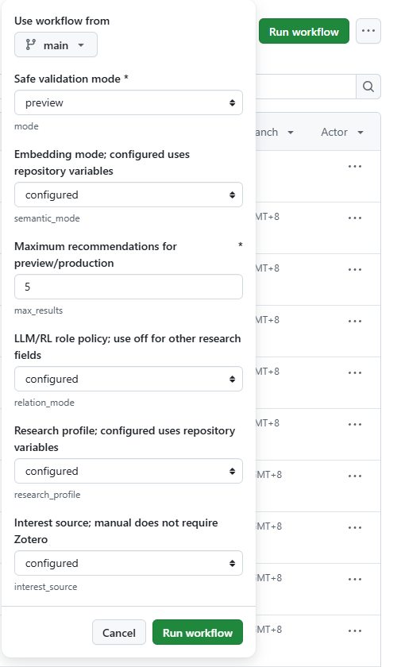

# CCF Paper Scout

CCF Paper Scout 是一个面向个人研究者的论文搜索与推荐工具，提供本地网页搜索和每日邮件推荐两个入口。它通过 DBLP、官方论文目录和 OpenAlex 获取候选及摘要，支持基于标题与摘要的关键词、向量和混合排序，以及阅读收藏、查询相关性反馈和离线评测。

| 使用方式 | 适合的场景 | 排序依据 |
|---|---|---|
| 本地网页搜索 | 围绕当前问题主动找论文、阅读与标注 | 本次查询与标题、摘要的相关性；默认语义＋关键词 |
| Daily 每日邮件 | 根据长期兴趣定期发现论文 | 手动兴趣或 Zotero 文献、主会资格及投递去重；可选语义排序 |

网页搜索不需要 Zotero、SMTP 或 LLM 凭据。Daily 支持无 Zotero 的手动兴趣模式，通过 GitHub Actions 和 SMTP 投递，可选调用 OpenAI-compatible API 生成中文论文卡片。两者复用采集与向量编码能力，使用独立的搜索/投递数据库；网页反馈不会自动训练模型或改变 Daily 推荐。

**首次部署每日邮件且没有 Zotero：从 [无 Zotero 部署指南](docs/deploy-without-zotero.md) 开始。** 只需填写自己的兴趣，先预览，再配置邮箱并开启 Daily。

Daily 基础示例配置的默认偏好（自定义用户请改用 `profiles/custom.json`）：

- 主要方向：强化学习（RL）、多智能体强化学习（MARL）、LLM-assisted RL；
- 拓展方向：LLM Agent；
- 默认每次最多推荐 5 篇，其中纯 LLM Agent 拓展论文最多 1 篇。

## Daily 工作流程

```text
GitHub Actions
  → 恢复私有状态
  → 读取手动兴趣画像，或 Zotero 兴趣文献
  → 按动态年份、独立来源预算和持久游标采集 DBLP／PMLR／OpenAlex
  → 保存完整候选库并周期复查；发现进度不依赖是否已推送
  → CCF-A 白名单与具体 proceedings／官方轨道证据硬过滤（未知暂缓）
  → 排除已推送论文；Zotero 模式同时排除已收藏论文
  → 在来源预算内完成官方页面／DOI 精确摘要补全
  → 归一化词项排序，可选 CPU embedding / 相关性复核
  → LLM／RL 作用方向原型与独立证据复核（默认 shadow，正式模式强制准入）
  → 质量门槛与新发现/历史队列，最多 5 篇，不用其他方向补位
  → LLM 生成中文论文卡片（可选）
  → SMTP 投递
  → 持久化 SQLite 和去重状态
```

LLM 不参与 CCF-A 出版资格判断和去重。关系复核与最终中文卡片分开，每轮最多审核 20 篇边界候选，要求摘要原句证据。Daily 的 CPU embedding 默认关闭，可先使用 shadow 模式评估；正式接管兴趣排序需要匹配模型与画像的人工审查校准，关系原型另有独立的校准版本。

部署、更新和来源异常处理见 [Daily 运维与恢复指南](docs/main-rollout.md)；需要启用正式语义排序时，先完成 [离线评测与校准](docs/offline-benchmark.md)。

## 网页搜索：快速开始

以下命令在已包含网页与手动兴趣功能的版本中使用。在仓库根目录运行；Windows 推荐 Python 3.12。已有仓库和虚拟环境时，跳过克隆与环境创建步骤。升级安装前先在原服务窗口按 `Ctrl+C` 停止服务，避免 Windows 可执行文件被占用。

### Windows / PowerShell

```powershell
git clone https://github.com/ademjest/ccf-paper-scout.git
cd ccf-paper-scout
py -3.12 -m venv .venv
.\.venv\Scripts\python.exe -m pip install --no-cache-dir .
.\.venv\Scripts\ccf-paper-scout.exe serve --config config.example.json
```

### Linux / macOS

```bash
git clone https://github.com/ademjest/ccf-paper-scout.git
cd ccf-paper-scout
python3 -m venv .venv
source .venv/bin/activate
python -m pip install --no-cache-dir .
ccf-paper-scout serve --config config.example.json
```

浏览器打开 [http://127.0.0.1:8765](http://127.0.0.1:8765)。服务仅监听本机，使用期间保持终端运行。基础安装即可使用关键词搜索；要启用默认选中的语义＋关键词匹配，还需完成下面的一次性模型准备。模型不可用时页面会提示并回退关键词排序。

### 启用本地语义匹配（可选）

停止服务后，在仓库根目录执行以下 PowerShell 命令。Linux/macOS 激活虚拟环境后，将 `.\.venv\Scripts\python.exe` 换成 `python`；macOS 安装 torch 时省略 `--index-url`，使用默认包源。以下固定依赖组合已在 Python 3.11/3.12 验证。

```powershell
.\.venv\Scripts\python.exe -m pip install torch==2.6.0 --index-url https://download.pytorch.org/whl/cpu
.\.venv\Scripts\python.exe -m pip install ".[semantic]" -c constraints-semantic.txt
.\.venv\Scripts\python.exe -c "from sentence_transformers import SentenceTransformer; SentenceTransformer('BAAI/bge-small-en-v1.5', revision='5c38ec7c405ec4b44b94cc5a9bb96e735b38267a', device='cpu', trust_remote_code=False, cache_folder='.model-cache/hub')"
.\.venv\Scripts\ccf-paper-scout.exe serve --config config.example.json
```

模型准备需要联网下载；搜索时只使用本地缓存模型和 CPU，无需 GPU 或付费 embedding API。当前模型主要面向英文，建议输入英文研究问题。

### 网页怎么用

1. 输入研究问题，选择年份和发表范围。默认只展示正式期刊/会议论文且必须有有效摘要，排除预印本、学位论文和发表状态未核实的记录。
2. 选择“语义＋关键词”“语义匹配”或“关键词匹配”，点击“查找论文”。先展示关键词结果，联网补充结束后再完成语义排序。
3. 展开摘要、打开论文，使用收藏与已读按钮整理阅读进度。相关性反馈为“很有帮助”“有些帮助”“没有帮助”，对应原来的 2/1/0 分。
4. 从“最近搜索”恢复结果。历史保留当时的论文和排序；使用新算法需重新发起搜索。

“来源与搜索选项”可调整来源或只查本地库。默认来源是 OpenAlex、PMLR、NeurIPS、ACL、CVF 和 AAAI；Crossref、arXiv、DBLP 可按需开启。启用 arXiv 不会自动放宽发表范围，查看预印本需同时选择包含预印本的范围。

语义匹配使用标题与摘要共同生成 384 维向量，长摘要分段处理；混合排序融合词项和向量两路排名。论文不必先命中关键词才可进入向量候选。向量缓存存入 `state/search.sqlite3`，摘要变化后自动重算；模型缓存为 `.model-cache/hub`。每次默认最多新计算 500 篇，覆盖不完整或模型不可用时页面会明确提示。首次加载和编码需要额外时间，后续可复用缓存。

向量搜索覆盖已经抓取的本地候选，不是全网向量检索；联网来源仍使用各自查询接口和官方目录。详见 [语义搜索原理、配置与评测](docs/search-semantic-ranking.md)。

命令行也可指定模式（CLI 默认仍为关键词）：

```powershell
.\.venv\Scripts\ccf-paper-scout.exe search --config config.example.json --query "world model planning" --ranking hybrid --require-abstract
```

来源预算、凭据配置和异常恢复见 [Daily 运维与恢复指南](docs/main-rollout.md)。

“反馈数据与评估（可选）”支持导出查询反馈和 AI 协作任务。人工与 AI 标签分开保存，独立测试样本不进入 AI 待标注包；可对固定结果快照重跑评测。操作步骤与指标边界见 [搜索反馈与评测说明](docs/search-feedback-and-evaluation.md)。

来源抓取支持逐篇恢复、摘要身份核对和响应缓存，区分访问失败与预算耗尽。单篇异常不会直接丢弃整个目录进度，来源失败时仍可展示已取得的本地结果。

## 环境要求

- Python 3.11+；本地语义匹配推荐 Python 3.12
- 仅运行网页搜索无需 Zotero、SMTP 或 LLM 凭据
- Daily 可用手动兴趣模式；只有选择 Zotero 模式时才需要数字 User ID 和只读 API Key
- 使用邮件投递时需要 SMTP 账号
- 使用中文论文卡片时需要 OpenAI-compatible API
- 使用 GitHub Actions 正式投递时需要一个私有 GitHub 状态仓库

## Daily 本地运行

如果已完成网页快速安装，可直接复制配置：

```bash
git clone https://github.com/ademjest/ccf-paper-scout.git
cd ccf-paper-scout
python3 -m venv .venv
source .venv/bin/activate
python -m pip install .
cp config.example.json config.json
```

不使用 Zotero 时，在复制后的 `config.json` 中设置以下字段，并编辑 `profiles/custom.json`：

```json
{
  "interest_source": "manual",
  "research_profile_file": "profiles/custom.json",
  "relation_policy": {"enabled": false, "mode": "shadow"},
  "llm_translation": {"enabled": false}
}
```

这是需要修改的配置片段，不是完整配置。兴趣文件可以只含 `explicit_interests` 非空英文关键词数组；省略的检索词、主题优先级和方向描述会从这组关键词生成。参考 [完整兴趣示例](profiles/custom.json)。

使用 Zotero 时保持 `interest_source=zotero`（未填写时的兼容默认值），再设置凭据：

```bash
export ZOTERO_USER_ID='你的数字 User ID'
export ZOTERO_API_KEY='你的只读 API Key'
```

检查配置：

```bash
ccf-paper-scout doctor --config config.json
```

生成本地报告：

```bash
ccf-paper-scout run \
  --config config.json \
  --output recommendations.md \
  --no-update-seen
```

`--no-update-seen` 表示预览，不把论文记录为已投递。正式运行时不要添加该参数。

## 主要配置

编辑复制得到的 `config.json`：

- `year_policy`：默认按北京时间自动查询当前年与上一年，并低频探测下一年；固定年份使用 `year_policy.mode=fixed` 和 `years`；
- `venue_keys`：允许检索的 DBLP venue key；
- `dblp`：分页、全局限速、瞬时错误重试、SPARQL 降级和部分分区失败策略；
- `max_results`：Daily 每次最多推荐数量，示例配置当前为 5；
- `selection`：质量门槛、是否允许仅标题、探索上限和新发现队列；
- `semantic`：Daily 可选 CPU embedding，固定模型 revision、增量预算与 shadow/production 模式；
- `search.semantic`：网页/手动搜索使用的本地模型缓存位置和增量编码预算；相对模型路径以启动目录为准；
- `search.state_db`：独立搜索库，默认 `state/search.sqlite3`，不能与 Daily 数据库相同；
- `main_conference`：主会资格硬过滤、历史候选论文集回填预算；
- `relation_policy`：LLM→RL、RL→LLM、LLM 多智能体 RL 独立分类与证据复核；非 RL 方向建议关闭；
- `interest_source`：`manual` 或 `zotero`，决定是否读取 Zotero；
- `research_profile_file`：可选兴趣 JSON 文件，相对路径以配置文件所在目录为准；
- `explicit_interests`：显式主要研究方向，手动模式必须非空；
- `topic_priority.primary_topics`：主要方向；
- `topic_priority.exploration_topics`：拓展方向；
- `topic_priority.max_exploration_results`：拓展方向最大篇数；
- `metadata.max_requests_per_run`：OpenAlex 每次运行的请求上限，默认 200，缺摘要与失败结果会缓存；
- `recent_interest_items`：用于兴趣建模的近期 Zotero 文献数量；
- `zotero_collection_keys`：限定参与兴趣建模的 Zotero collections；
- `state_db`、`seen_db`：SQLite 和兼容去重状态路径。

私人凭据只能通过环境变量或 GitHub Actions Secrets 提供，不要写入 `config.json` 或提交到 Git。

### DBLP 可用性与降级

DBLP Search API 可能对云端出口返回 HTTP 200 的反机器人 HTML 页面。程序会先检查
`Content-Type` 和正文特征，不会把验证页面当作 JSON 重试；两个 Search API 域名均不可用时，
独立搜索接口调用会熔断并降级到官方 SPARQL 服务；持久发现默认直接使用 SPARQL，并固定
单轮 transport，避免跨端点混用分页偏移。`dblp.request_delay_seconds` 应保持至少
2–3 秒，使所有 DBLP 请求共享同一个进程级间隔。`dblp.max_attempts` 只作用于 429、5xx、
超时和连接中断，不作用于反机器人页面或结构错误。

当前多来源流程保留其他来源和已有缓存的合格候选，并在报告中注明来源异常。仅使用旧 DBLP
发现流程时，`minimum_success_ratio` 仍检测异常；示例配置允许临时故障时使用缓存，严格模式
则停止运行。缓存候选仍需通过原有资格、相关性和去重检查。故障处理见
[Daily 运维与恢复指南](docs/main-rollout.md)。

## 本地命令

需要比较词项与语义排序、保存完整候选快照或制作人工标注集时，见
[离线排序评测指南](docs/offline-benchmark.md)。该流程使用独立实验目录，不发送邮件。

```bash
ccf-paper-scout --help
ccf-paper-scout doctor --config config.json
ccf-paper-scout test-delivery --config config.json
ccf-paper-scout run --config config.json --output recommendations.md
```

## GitHub Actions 部署

完整的逐步操作、兴趣文件说明、邮箱设置和页面截图见 [无 Zotero 部署图文指南](docs/deploy-without-zotero.md)。已有 Zotero 用户可以保留原配置；新用户推荐以下路径。

### 1. Fork 并填写兴趣

Fork 项目，启用 Actions，编辑自己 Fork 中的 `profiles/custom.json` 并提交到默认分支。关键词控制基础匹配，`discovery_queries` 控制联网检索，方向描述用于语义匹配。未填写的可选字段由本文件关键词生成，不沿用作者的 RL 画像。

### 2. 创建私有状态仓库

创建自己的 Private 仓库（例如 `你的账号/paper-scout-state`），勾选添加 README，确认分支是 **main**。用 Fine-grained token 仅授权这个仓库的 **Contents: Read and write**，把令牌保存为代码仓库 Secret `STATE_REPO_TOKEN`。

状态仓库保存候选缓存、投递历史和私有预览报告。不要共享作者或其他用户的状态库；无需手动创建 SQLite。注意令牌有效期，过期后需要更新 Secret。

### 3. 添加 Variables 与 Secrets

在**代码仓库** Settings → Secrets and variables → Actions 配置：

| Variables | 无 Zotero 新用户建议值 |
|---|---|
| `STATE_REPO` | `你的账号/paper-scout-state` |
| `INTEREST_SOURCE` | `manual` |
| `RESEARCH_PROFILE` | `custom` |
| `SEMANTIC_MODE` | `off` |
| `RELATION_MODE` | `off`（LLM/RL 专用策略，其他方向应关闭） |
| `LLM_ENABLED` | `false` |

预览仅需 `STATE_REPO_TOKEN`。准备投递时再添加 Secrets `SMTP_SENDER`、`SMTP_RECEIVER`、`SMTP_PASSWORD`，分别为发件地址、收件地址、SMTP 授权码/应用密码。

邮箱服务器通过 Variables `SMTP_HOST`、`SMTP_PORT`、`SMTP_USE_SSL` 设置。未设置时兼容原 QQ 邮箱组合 `smtp.qq.com / 465 / true`；其他邮箱按服务商文档填写。`SMTP_USE_SSL=false` 表示 STARTTLS（通常 587），不是明文发送。

可选配置：

- Zotero：`INTEREST_SOURCE=zotero`，添加 Secrets `ZOTERO_USER_ID`、`ZOTERO_API_KEY`。
- 中文卡片：`LLM_ENABLED=true`，添加 Secrets `LLM_BASE_URL`、`LLM_MODEL`、`LLM_API_KEY`。未设置开关但已有前两个字段时兼容旧部署，仍默认启用；明确设为 false 可关闭所有推荐流程中的 LLM 网络调用。
- 语义比较：`SEMANTIC_MODE=shadow`；production 仍需审核校准，不能直接将网页混合排序的设置当作 Daily 校准。
- OpenAlex 凭据：如接口要求，配置 Secret `OPENALEX_API_KEY`；可按来源需求补充其他服务凭据。

### 4. 预览、验证投递、启用 Daily

在 **Paper Scout Manual → Run workflow** 选择默认分支：

1. `mode=preview`，其余模式选项保留 `configured`，表示沿用上述 Variables。无需邮箱或 Zotero，结果保存到私有状态仓库 `reports/<run-id>/`，不发邮件、不更新投递历史。
2. 添加邮箱配置后运行 `doctor`，再运行 `smtp-test` 验证实际收件。
3. 运行一次 `production`，建议首次 `max_results=3`，确认邮件与状态保存成功。
4. 启用 **Paper Scout Daily**，等待下一次调度。每天上限目前为 5 篇，没有合格论文不会凑数。

下面是预览表单：选择 `preview`，其余模式保持 `configured`，使用自己配置的兴趣和开关。



Manual 还提供 `discover`（只更新发现库）、`evaluate`（评估已有候选）和 `research`（内置 RL 公开研究实验）。手动模式选择会覆盖仓库 Variables，仅影响该次运行。Fork 不会复制原作者的 Secrets，需自行配置。

Actions 负责批次检索与投递，不托管常驻网页；网页使用本机 `serve`。定时任务使用默认分支代码，功能分支需要先合并才生效。部署升级与恢复步骤见 [Daily 运维与恢复指南](docs/main-rollout.md)。

## 使用指南

| 指南 | 内容 |
|---|---|
| [无 Zotero 部署](docs/deploy-without-zotero.md) | 自定义兴趣、状态仓库、邮箱和 Actions 图文步骤 |
| [Daily 运维与恢复](docs/main-rollout.md) | 更新、来源配置、超时降级和令牌故障 |
| [网页语义搜索](docs/search-semantic-ranking.md) | 本地模型、标题与摘要匹配、缓存与排序 |
| [搜索反馈与评测](docs/search-feedback-and-evaluation.md) | 阅读反馈、人工与 AI 协作标注、固定快照评测 |
| [离线排序评测](docs/offline-benchmark.md) | 采集、摘要补全、盲标与 Daily 语义校准 |
| [研究画像实验](docs/research-actions.md) | 使用公开数据运行内置 RL 画像对比实验 |

## 每日发送时间

Daily workflow 在前一天 UTC 20:00（北京时间当天 04:00）请求启动。该提前量用于补偿 GitHub Actions 定时任务常见的排队延迟。应用会在 SMTP 调用前执行北京时间 09:00 门控：

- 提前完成准备时等待至 09:00；工作流最长允许运行 6 小时，以覆盖提前启动后的等待和正常处理时间；
- 09:00 后才完成准备时不再取消当天发送，而是立即发送并在日志中记录迟到秒数；
- 手动 workflow 不受该门控影响。

GitHub-hosted schedule 是 best-effort，提前调度只是根据历史延迟进行经验补偿，不能提供严格的准点 SLA。如果必须保证每天准时，应改用具有调度时效保证的外部平台。

## 投递和去重安全

系统只在 SMTP 服务端接受邮件后把论文标记为 delivered。生产运行在 SMTP 前持久化 `.delivery-pending`：

```text
准备报告
→ 写入并推送 delivery_pending
→ 调用 SMTP
→ SMTP accepted
→ 更新 SQLite 和 seen.json
→ 清除 pending 并推送最终状态
```

如果系统无法确认邮件是否已发送，会保留 pending 并阻止下一次自动 production，以减少重复邮件风险。

## 隐私边界

- Zotero 文献在运行环境中用于本地兴趣建模；
- DBLP 接收 venue、年份和查询参数；
- OpenAlex 等检索接口接收查询词或候选 DOI，官方目录来源接收论文集和详情页请求；
- 网页 embedding 在本机计算，模型准备阶段会下载公开权重；
- 翻译 LLM 接收最终入选论文的标题、摘要和显式兴趣方向；独立关系复核还会接收每轮有预算上限的边界候选标题及摘要；
- 完整 Zotero 文库、推荐历史、SQLite、SMTP 授权码和各类 API Key 不应进入公开仓库；
- 个人论文库、模型缓存及 `local-notes/` 内的标注和调试导出由 `.gitignore` 保持在本地；公开代码、自动化测试和 `docs/` 使用文档纳入版本控制。

## 数据与许可证

项目代码采用 Apache-2.0，详见 `LICENSE`。

运行时打包的 CCF-A venue 映射位于：

```text
src/ccf_paper_scout/data/ccf_a_venues.json
```

该映射是从 `WenyanLiu/CCFrank4dblp` 固定版本转换得到的 CCF-A 子集，原始数据采用 MIT License。完整第三方声明见 `THIRD_PARTY_NOTICES.md`。该映射不是 CCF 官方 API，使用时应以最新 CCF 官方目录和正式 proceedings 为准。

## 能力边界

- DBLP 已索引的正式论文不等于最新投稿或预印本；
- DBLP Search API 和 SPARQL 都是外部服务；自动降级可以减少单点故障，但不能提供可用性 SLA；
- OpenAlex 可能缺少摘要；
- 网页支持词项、语义和混合排序，但相关性分数不是论文质量评分；当前英文 embedding 模型不保证中文跨语言检索效果；
- 向量匹配无法弥补尚未抓取的论文和缺失摘要；目前单个完整人工标注开发查询上的改善不能代表整体效果；
- LLM 输出是基于标题和摘要的辅助解读，不等于阅读全文后的严格评审；
- GitHub Actions 和 SMTP 无法构成绝对原子事务；
- 当前项目面向单个研究者和单个私有状态仓库。
