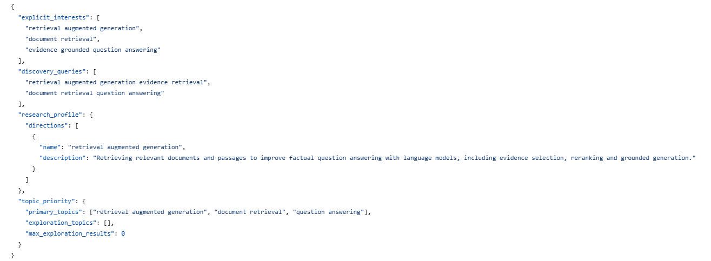
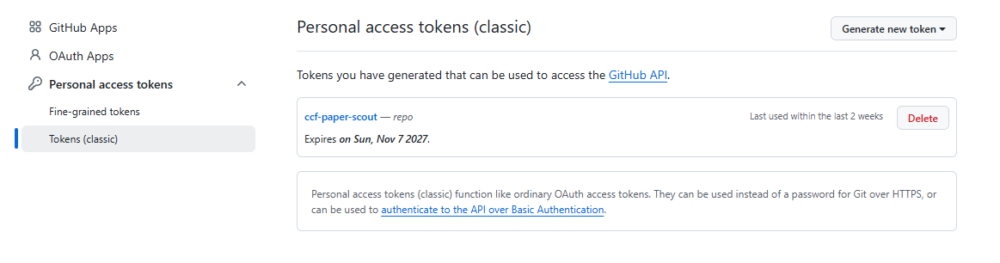
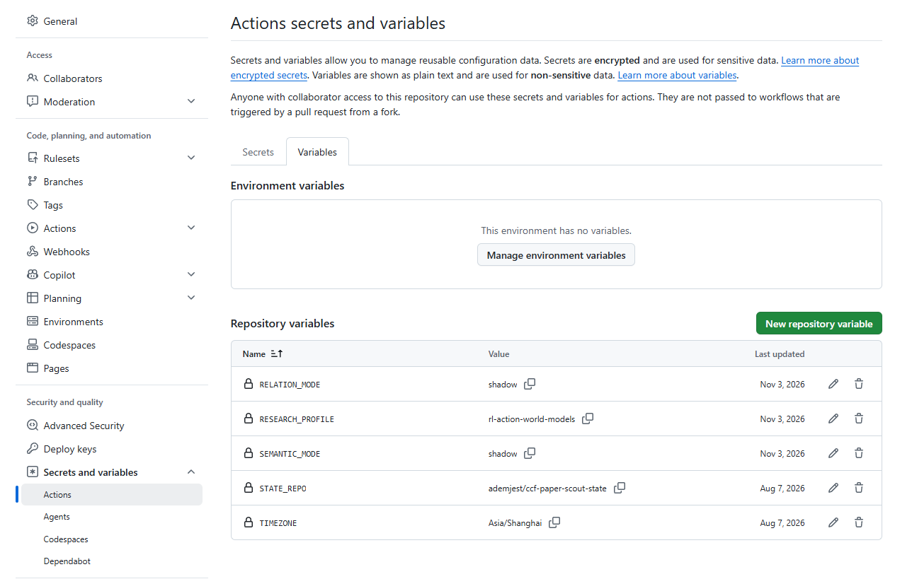
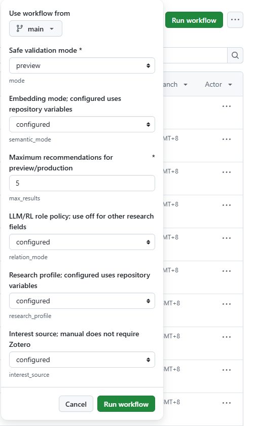
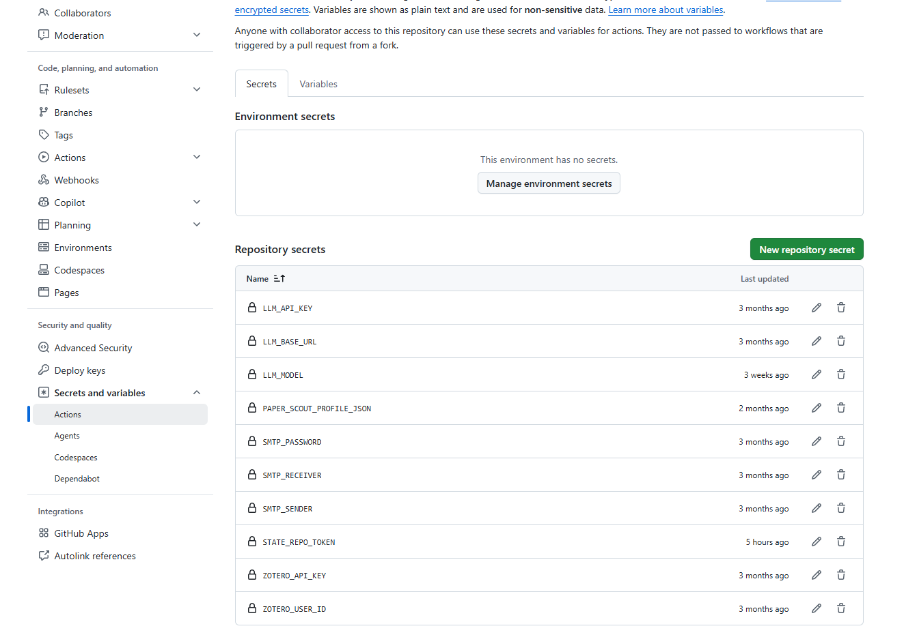

# 无 Zotero 部署指南

本指南适合 Fork 后通过 GitHub Actions 每日收取论文的个人用户。无需 Zotero，也无需 LLM API；可先完成不发送邮件的预览。推荐仍受 CCF-A 会议、年份、主会资格与摘要要求限制，填写研究方向不会自动扩大到全部期刊或所有学科。

## 1. 准备自己的代码仓库

Fork 本项目，后续配置都在你自己的 Fork 中完成，不要使用原作者的状态仓库或 Secret。在 Fork 的 Actions 页面启用工作流。首次配置期间先暂停 `Paper Scout Daily`，完成预览和投递测试后再启用。

本指南对应已包含 `interest_source`、`profiles/custom.json` 和 Manual 中 `configured` 选项的版本。若 Fork 中看不到这些内容，请先同步包含该功能的版本；只修改设置不会给旧代码增加新功能。

## 2. 填写兴趣方向

打开 Fork 中的 `profiles/custom.json`，点击编辑，将示例改为自己的方向并提交到默认分支。最简内容：

```json
{
  "explicit_interests": [
    "retrieval augmented generation",
    "document retrieval",
    "evidence grounded question answering"
  ]
}
```

关键词建议使用英文，写具体方法或任务，避免只有 `AI`、`deep learning` 这样的宽泛词。省略其他字段时，程序自动用这些关键词作为检索词、主要方向与语义方向描述，不会继承原作者的 RL 主题。

仓库中的完整示例还展示以下可选字段：

| 字段 | 用途 |
|---|---|
| `discovery_queries` | 联网检索词组；可以比兴趣关键词更具体 |
| `research_profile.directions` | 每项填写 `name` 和英文 `description`，说明实际研究问题；开启语义模式后参与匹配 |
| `topic_priority.primary_topics` | 主要研究方向；词项模式会检查题名与摘要中的主题匹配 |
| `topic_priority.exploration_topics` | 少量拓展方向，不需要时填写空数组 |
| `venue_keys` | 可选会议范围，仍必须来自项目 CCF-A 白名单 |

`RESEARCH_PROFILE=custom` 使用这个文件；`legacy` 使用 `config.example.json` 的兴趣；`rl-action-world-models` 是项目内置的 RL 画像。私有研究方向不应提交到公开 Fork，可使用私有代码仓库或本地私有配置。

下图是 `profiles/custom.json` 的完整内容示例，展示 RAG 方向的写法。请按自己的研究问题修改；只填写上面的最简内容也可以。



## 3. 创建私有状态仓库

在自己的账号下创建 **Private** 仓库，例如 `paper-scout-state`，勾选添加 README，让仓库至少有一个提交，并确认默认分支为 **main**。当前状态推送目标固定为 main。

程序会自动创建 `state/`，保存论文候选、抓取进度与已投递记录。不要复制原作者的状态；其他人的已投递历史也不适合你的账号。已有自己的状态仓库时继续使用，不要清空。

创建 Fine-grained personal access token：个人头像 → Settings → Developer settings → Personal access tokens → Fine-grained tokens → Generate new token。

- Resource owner：状态仓库所属账号。
- Repository access：Only select repositories，只选择刚创建的私有状态仓库。
- Repository permissions：Contents → Read and write。
- Expiration：按需要设置有效期，记住到期前更换；组织仓库还需要相应审批。

生成后的值保存到代码仓库 Secret `STATE_REPO_TOKEN`。名称相同不代表两个账号共享令牌；Fork 不会复制原作者的 Secrets。不要截取或公开令牌值。

下图是已有 **Classic token** 的管理页，展示有效期与 `repo` 权限，**不是 Fine-grained 的权限配置页**。新用户按上面的步骤选择左侧 **Fine-grained tokens**，只授权自己的状态仓库；已有 Classic 用户可在此检查是否过期，更新后还需替换 `STATE_REPO_TOKEN`。



## 4. 配置 Variables

在**代码仓库** Settings → Secrets and variables → Actions → Variables → New repository variable 中添加：

| Name | Value | 说明 |
|---|---|---|
| `STATE_REPO` | `你的账号/paper-scout-state` | 不带 URL 或 `.git` |
| `INTEREST_SOURCE` | `manual` | 不读取 Zotero |
| `RESEARCH_PROFILE` | `custom` | 使用自己的兴趣文件 |
| `SEMANTIC_MODE` | `off` | 首次先验证基础推荐；可选 shadow 比较语义排序 |
| `RELATION_MODE` | `off` | 关闭专用于 LLM/RL 作用方向的策略 |
| `LLM_ENABLED` | `false` | 使用原文论文信息，不调用 LLM |

以后只修改 `profiles/custom.json` 并提交，就能更新 Daily 的兴趣。Manual 的兴趣与模式选项默认 `configured`，表示沿用这些 Variables；手动选择其他值只影响本次运行。

不配置 `INTEREST_SOURCE` 时沿用 `config.example.json`，仓库示例为 `zotero`，这是为已有用户保留的兼容默认值。无 Zotero 用户需要明确设置 `manual`。

下图用于定位 **Variables** 页和 **New repository variable** 按钮。图中是作者的 RL 配置，**请使用上表的无 Zotero 配置，不要照抄图中的值**：将 `RESEARCH_PROFILE` 设为 `custom`、两种模式设为 `off`，补充 `INTEREST_SOURCE=manual` 和 `LLM_ENABLED=false`，并把 `STATE_REPO` 改为自己的仓库。



## 5. 先做不发邮件的预览

此时只需 `STATE_REPO_TOKEN`，暂时不用配置邮箱、Zotero 或 LLM Secrets。

Actions → Paper Scout Manual → Run workflow：选择默认分支，`mode=preview`，其余模式选项保持 `configured`，`max_results=5`。



检查：

1. `Restore private state` 成功。
2. 日志显示 `Loading interests from manual research profile` 及自己的关键词。
3. `Save private preview and evaluation reports` 成功。
4. 打开自己的私有状态仓库 `reports/<run-id>/recommendations.md` 查看结果。

预览不会发邮件、不会更新生产投递历史，但会把报告提交到私有状态仓库。初次发现库为空时仍需联网抓取；上游超时或没有满足主会/摘要条件的论文，结果可能为空。`max_results` 是上限，不会为了凑数推荐无关论文。可用 `discover` 模式积累发现库后再预览；discover 会保存抓取进度，但不投递。

## 6. 配置自己的邮箱

在代码仓库 Actions 的 **Secrets** 页添加：

| Secret | 内容 |
|---|---|
| `SMTP_SENDER` | 发件邮箱地址，同时用于 SMTP 登录 |
| `SMTP_RECEIVER` | 收件邮箱地址 |
| `SMTP_PASSWORD` | 邮箱提供商的 SMTP 授权码/应用密码 |

下图用于定位 **Secrets** 页和 **New repository secret** 按钮，只显示名称，不显示密钥值。无 Zotero、关闭 LLM 时，基础部署只需 `STATE_REPO_TOKEN` 和上面三个 SMTP Secrets；图中其他名称无需照建，`PAPER_SCOUT_PROFILE_JSON` 也不是当前工作流的配置入口，兴趣请写入 `profiles/custom.json`。



在 **Variables** 页配置服务器：

| Variable | 示例/含义 |
|---|---|
| `SMTP_HOST` | 邮箱服务商给出的 SMTP 主机；未设置时兼容原配置使用 `smtp.qq.com` |
| `SMTP_PORT` | 服务商要求的端口，例如 465 或 587 |
| `SMTP_USE_SSL` | `true` 为隐式 TLS，通常配 465；`false` 为 STARTTLS，通常配 587，并非明文发送 |

仅使用 QQ 邮箱默认组合时可以省略这三个 Variables。其他邮箱请按服务商文档填写；当前支持账号＋授权码/密码登录，不支持只接受 OAuth 的邮箱认证。

依次运行 Manual：

1. `doctor`：检查手动兴趣、邮箱字段、密码是否存在及基础连接。不会发邮件，也不检查私有状态令牌。
2. `smtp-test`：发送一封测试邮件，不抓取论文，不改变投递历史。
3. `production`：建议首次 `max_results=3`，确认真实推荐邮件和状态保存都成功。

`smtp-test` 和 `production` 会发邮件。没有合格论文时 production 不会为了测试而发送空推荐；邮箱连接请使用 smtp-test 验证。

## 7. 开启 Daily

Actions → Paper Scout Daily → Enable workflow。Daily 自动使用仓库 Variables 和 Secrets，当前工作流每天最多推荐 5 篇；若需调整，须同步修改工作流配置生成参数和后面的数量校验。

定时任务以默认分支代码运行。当前 UTC 20:00 调度准备（北京时间次日 04:00），程序不早于北京时间 09:00 投递，GitHub 排队延迟可能使投递晚于 09:00。手动点击 Daily 的 Run workflow 会直接执行真实投递，不受定时等待限制。

公开仓库可能因长期无活动被暂停 schedule；定期检查 Actions 是否仍启用，状态令牌是否即将过期。

## 可选能力与原有用户

- **Zotero**：设置 `INTEREST_SOURCE=zotero`，再添加 `ZOTERO_USER_ID`、`ZOTERO_API_KEY`。自己的手动兴趣文件仍可与 Zotero 共同使用。缺失 Zotero 凭据时会报错，不会偷偷退回另一种画像。
- **中文论文卡片**：设置 Variable `LLM_ENABLED=true`，添加 Secrets `LLM_BASE_URL`、`LLM_MODEL`、`LLM_API_KEY`。关闭时设置 `false`，关系/相关性 LLM 复核也不联网。为兼容旧部署，未设置开关但已有 `LLM_BASE_URL` 和 `LLM_MODEL` 时仍默认启用。
- **语义比较**：`SEMANTIC_MODE=shadow` 在 CPU 上比较词项与向量排序，可能增加首次运行耗时。Daily 的 production 语义模式仍要求匹配当前画像的审核校准；网页混合排序可用不代表 Daily 已自动开启。
- **LLM/RL 关系策略**：研究其他方向时保持 `RELATION_MODE=off`。这是领域专用规则，不是通用论文质量筛选器。
- **本地参考论文**：已有 CLI `--interests papers.json` 仍可提供标题、摘要等参考文献并覆盖配置中的兴趣来源，无需伪造 Zotero 凭据。

无 Zotero 模式保留邮件投递历史去重；无法自动获知你在其他工具里收藏或读过的论文。

## 部署完成检查

- 兴趣文件已提交，Variables 指向自己的画像和私有状态仓库。
- Preview 日志显示自己的关键词，私有仓库中能够打开预览报告。
- SMTP 测试邮件已收到，首次 production 的邮件和状态保存均成功。
- Daily 已启用，状态令牌尚未过期。

以上截图用于说明页面位置和操作方式；配置值以本文表格及自己的仓库、兴趣和邮箱为准。无需提供额外截图才能部署。与状态恢复、令牌过期有关的故障处理见 [Daily 运维与恢复指南](main-rollout.md)，不要通过清空状态库解决认证问题。
