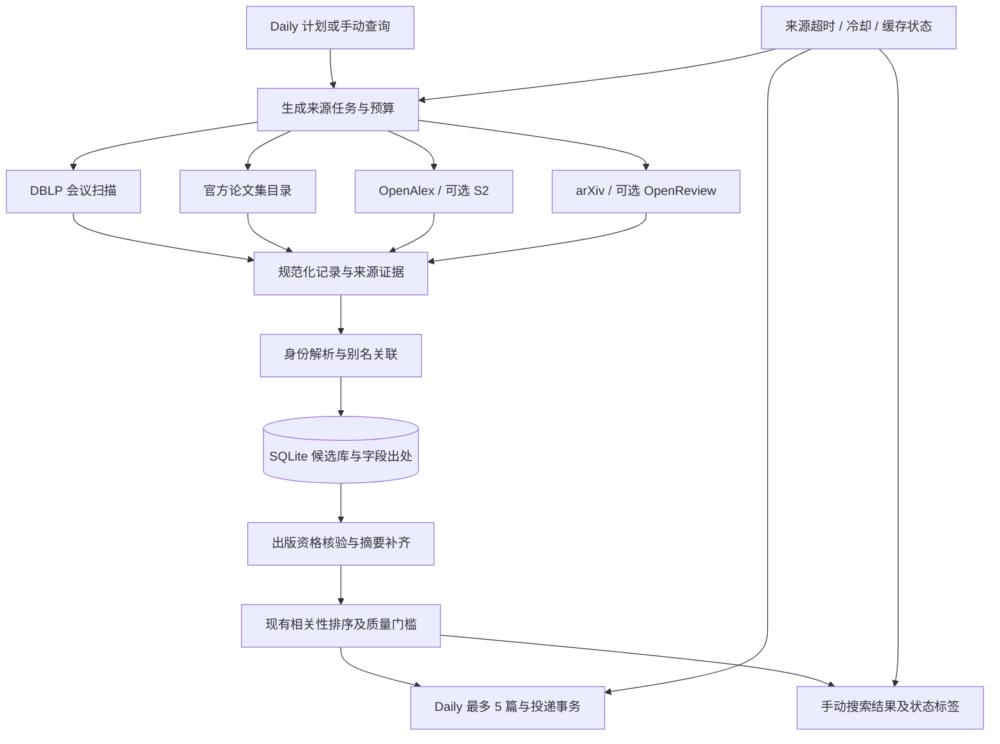

# CCF Paper Scout 多数据源与检索可靠性升级方案

> 版本：v1.0，2026-11-04。本文是待实施方案，不表示下述接口、配置或命令已经上线。
> 对照基线：本地 `655f58b`，包含 DBLP 临时故障时使用扫描前缓存的修复；每日上限为 5 篇。部署前应重新核对 main 与 PR #16 的合并状态。
> 研究范围：当前代码、ResearchStudio 指定版本源码、官方接口资料、公开接口的小样本访问。未使用用户 API key，未发送邮件，未修改生产数据库。
> 实施进展：2026-11-04 已完成可用闭环与本地搜索；实际字段、验证结果及尚未完成的观察见 [实施说明](multi-source-implementation.md)。本方案保留为设计依据，以下草案不自动代表已实现接口。

## 1. 决策摘要

采用“多个独立发现来源 + 官方出版证据 + 统一候选库 + 有时限的采集 + 缓存降级”。首个可交付版本只接入 **DBLP、PMLR/ICML 官方目录、OpenAlex**；随后扩展其他官方目录及 arXiv。Semantic Scholar、OpenReview 先完成访问条件验证，再纳入正式运行。

每日推荐与未来手动搜索复用连接器、身份解析和缓存，但使用不同准入策略：

- **Daily**：只选当前允许会议／年份范围内、已核验主会资格、满足摘要和研究方向门槛、未投递且未在 Zotero 收藏的论文；最多 5 篇。
- **手动搜索**：可以展示 arXiv 预印本、待核验稿件和历史论文，明确标注出版状态；搜索行为不自动写入邮件已投递历史。
- **故障策略**：健康来源的新结果可以继续进入筛选；全部实时来源不可用时使用已验证缓存。报告说明实际覆盖与缺失来源，不把缓存或部分覆盖称为“完整今日检索”。

第一阶段继续使用 Python、SQLite 和 GitHub Actions，不引入消息队列、独立向量数据库或常驻爬虫集群。当前语义排序、关系策略维持 shadow；数据源升级与排序算法评估分开验收。

## 2. 当前问题与代码约束

### 2.1 已有证据

2026-11-04 的 Daily 在 13 个活跃会议／年份分区中，有 7 个读取超时、2 个 HTTP 503，成功率为 4/13。三次重试后扫描未通过 0.75 门槛，SMTP 尚未执行；扫描状态保存成功。

该次失败后保存的状态副本包含 17,544 条候选记录，其中 199 条有摘要、10,019 条包含论文集 ID。这是**整个缓存的元数据统计**，包括未核验和不相关记录，不能解释成有 17,544 篇可推荐论文。后续需要按“未投递 + 方向相关 + 主会已核验”分别计算摘要覆盖率。

当前已有 PMLR、NeurIPS、ACL 官方单篇摘要获取和 OpenAlex DOI 补全，但发现入口主要是 DBLP。因此扩展摘要接口不能单独解决 DBLP 发现不可用的问题。

### 2.2 必须修改的耦合点

| 位置 | 当前行为 | 升级要求 |
|---|---|---|
| `src/ccf_paper_scout/discovery.py` | 按 DBLP 会议／年份分页及计算成功率 | 保留为 DBLP 连接器；新增跨来源调度层 |
| `paper_scout.py:run_pipeline_body` | 按 `conf/<venue>/...` 等 ID 前缀过滤 | 改为规范会议映射、身份关联和出版证据，不假造 DBLP ID |
| `src/ccf_paper_scout/proceedings.py:qualify` | 核验依赖 DBLP 论文集 ID 和论文 ID 前缀 | 支持官方目录成员资格证据；原 DBLP 证据路径继续有效 |
| `src/ccf_paper_scout/metadata.py` | 官方页面和 OpenAlex 共享摘要预算 | 扩展为按身份与来源能力选择补全路径 |
| `state_store.py` | 候选主键及部分缓存直接使用 DBLP ID | 增加别名／证据表，保留旧主键与投递记录 |
| `source_cursors` | 主要是会议／年份整数 offset | 新增通用任务游标表，支持 opaque cursor、目录快照和更新水位 |
| `.github/workflows/paper-scout-*.yml` | 直接运行单一管线 | 配置来源能力、预算、Secrets 注入和诊断汇总 |

**关键约束：OpenAlex 能搜到论文，并不意味着当前代码能接收它。** 如果仍要求每篇论文先拿到在线 DBLP ID 才能通过准入，新增来源仍依赖同一故障点。

## 3. ResearchStudio 的参考范围

参考版本：[microsoft/ResearchStudio@063f100](https://github.com/microsoft/ResearchStudio/tree/063f10088af49909e1a4a7ea8d29efe19633f34e/ResearchStudio-Idea/skills/paper_search)。

| 设计 | 已核实的实现 | 本项目的使用方式 |
|---|---|---|
| 来源连接器 | arXiv、DBLP、OpenAlex、OpenReview、Semantic Scholar、Crossref | 采用统一契约，按来源能力启用，不要求一次接齐 |
| 来源隔离 | 每个来源使用子进程；可并行执行 | 保留隔离思想；工作进程只采集，主进程统一写 SQLite |
| HTTP 策略 | 连接／读取超时分离；对部分 HTTP 状态有限重试 | 增加来源与任务总时限、重试等待预算和持久冷却 |
| 后处理 | DOI、arXiv ID、规范化标题匹配，补字段，保留 `found_in` | 使用字段级出处与冲突处理；不能仅凭同标题自动合并不同 DOI |
| 查询方式 | 同一组关键词发往多个来源 | 适用于手动检索；Daily 另需会议目录与时间水位任务 |

不直接沿用的行为：

1. 默认读取空闲超时 300 秒；`process.wait()` 没有来源总时限，不能保证总任务按时结束。
2. OpenReview 可回退到 `Submission`／`Blind_Submission` 列表；这不是正式录用证据。
3. `venue` 字符串和结果年份不足以证明主会身份；投稿时间也不等于会议年份。
4. OpenAlex 连接器采用 `search.semantic`，并按 200 条设定页大小；当前官方文档支持上限为 100，语义搜索应另行验证，不作为首期必需能力。
5. Google Scholar 连接器没有默认加入聚合来源；本方案也不将其作为无人值守 Daily 的基础依赖。

ResearchStudio 仓库为 MIT 许可；若后续复制其代码片段，应保留对应版权和许可说明。本文仅借鉴架构，未将其源码直接引入生产包。

## 4. 2026-11-04 接口核查结果

以下是当前 Windows 环境的一次小样本访问，不是 GitHub Runner 的 SLA，也不是完整分页测试。匿名请求未配置用户密钥；目录响应为 200 仍需结构及内容验收。

| 来源／检查 | 观察 | 对实施顺序的影响 |
|---|---|---|
| OpenAlex 普通关键词查询，1 条 | HTTP 200，有 JSON 和配额头 | 可先做发现连接器；正式启用游标前配置已激活 key |
| Semantic Scholar 查询，1 条 | HTTP 429；接口文档端点也被限流 | key 与 Runner 探测完成前保持可选来源 |
| Crossref 查询，1 条 | HTTP 200 | 适合作为 DOI、出版信息补全来源 |
| arXiv 查询，1 条 | HTTP 200，Atom XML | 可优先用于手动检索和新论文跟踪 |
| OpenReview API v2 notes，1 条 | HTTP 403，`ChallengeRequiredError` | 标记 `blocked`，不自动绕过挑战，不列为 Daily 必需来源 |
| DBLP FAQ 页面 | HTTP 202，但正文为 Anubis 验证页面 | HTTP 状态不能代替内容检测；不据此判定 SPARQL 同样不可用 |
| PMLR v267、ACL 2025 事件页、CVPR 2025 目录 | HTTP 200；初步检查只读取前 1.5 MB | 尚不能认定整页完整或全量论文数正确 |
| NeurIPS 2025 年份页 | HTTP 200，包含其他轨道并链接主会书册 | 不把年份根页直接当主会名单 |
| NeurIPS 2025 主会书册 | HTTP 200；解压后约 4.1 MB，仍含多个轨道 | 必须按条目 `data-track` 和已审核规则分流 |
| AAAI archive | HTTP 200；正确处理 gzip 后可见 issue 链接 | 需要卷／期／轨道映射；不能只匹配年份 |

复现记录保存在本地忽略目录 `local-notes/source-api-research/`。这些临时参考文件不随公开仓库发布；上线验收应生成新的脱敏报告。

**OpenAlex 文档变化已核实**：普通查询可匿名使用；游标第一页之后需要已验证邮箱的免费 key；支持的 `per_page` 最大值为 100，200 属于不应依赖的旧行为。官方文档更新于 2026-11-03。配额和请求成本以账户与响应头为准，不能将“免费 key”理解为无限调用。[S2][S3]

## 5. 目标架构与运行流程



Daily 单轮顺序：

1. 读入已有候选、已投递 ID／别名、Zotero 身份索引，形成运行起始快照。
2. 根据目录刷新时间、查询水位、配额和来源健康状态，生成有限任务。
3. 最多同时运行 2 个来源；同一 host 默认仅 1 个在途请求。
4. 每完成一页，先校验记录、来源与分页结构，再由主进程事务写入记录和游标；禁止先推进游标。
5. 到达来源期限或全局采集期限后停止该任务，保留已提交的完整页。
6. 新结果经过身份解析和主会证据检查；使用符合条件的新记录与旧缓存。任一来源失败不自动否定另一个独立来源的有效记录。
7. 按预算补摘要并执行现有排序；不足 5 篇按实际数量发送，零篇不发。
8. 邮件和诊断显示 `live / partial_live / cached_only`，并保留原 SMTP 事务门控和状态持久化。

第 6 步是对当前缓存修复的后续扩展：当前修复在 DBLP 整轮失败时只使用扫描前快照；新调度器上线前不改变该行为。新来源先 shadow 采集，通过故障与身份迁移测试后再允许独立推荐。

## 6. 统一接口契约

### 6.1 文件组织

建议在现有 `src/ccf_paper_scout/` 下新增：

```text
source_contracts.py      # 记录、任务、结果和预算契约
source_runtime.py        # 超时、退避、host 限流、冷却
source_scheduler.py      # 主进程调度、页结果收集、截止时间
source_worker.py         # 单来源受控执行，不写生产 SQLite
source_registry.py      # 显式注册内置来源与能力
identity.py             # canonical ID / aliases / conflict handling
sources/
  dblp.py
  openalex.py
  official_pmlr.py
  official_neurips.py
  official_acl.py
  official_cvf.py
  official_aaai.py
  semantic_scholar.py
  openreview.py
  arxiv.py
  crossref.py
```

按阶段创建文件，不先生成空连接器。当前 setuptools 显式列出了包，新增 `sources` 子包时必须更新 `pyproject.toml` 的包发现／列表，并验证安装到项目外后仍可导入。

HTTP 实现首期统一使用 `requests.Session`，新增 `requests>=2.32,<3` 依赖，并在部署约束文件中锁定实际测试通过的版本。使用 `(connect_timeout, read_timeout)`、连接复用和 `stream=True`；SDK／连接器不得绕过运行时自行发请求。HTTPAdapter 的隐式重试设为 0，由运行时统一计数，避免底层重试与业务重试相乘。迁移只覆盖数据源请求，现有 SMTP、Zotero 和 LLM 请求不在首期重构范围内。

XML 首期用标准库 ElementTree 解析受大小限制的 arXiv／Crossref 数据，拒绝 DTD／外部实体声明；HTML 单篇抽取复用现有 HTMLParser，目录使用站点专属解析器。收到 `Content-Encoding` 时正确解压，并分别限制传输字节与解压后字节；目录建议上限 12 MiB、单篇 HTML 2 MiB，超过上限必须显式失败。只访问配置内的官方 host，重定向需重新校验 host；避免从未知返回链接下载任意页面。

### 6.2 来源能力

| 能力 | 含义 | 主要实现者 |
|---|---|---|
| `search` | 关键词／方向检索，不保证穷尽 | OpenAlex、S2、arXiv、Crossref、DBLP Search |
| `scan_venue` | 枚举指定会议／年份／轨道 | 官方目录、DBLP SPARQL、经验证的 OpenReview |
| `lookup` | 按已有标识补记录 | OpenAlex、S2、Crossref、arXiv、官方单篇页 |
| `publication_evidence` | 提供可验证出版／录用证据 | 官方目录、经过规则核验的 OpenReview、现有 DBLP 论文集路径 |

来源必须声明能力；不支持某操作时返回配置错误，不能默默换成不等价的查询。

### 6.3 最小 Python 接口草案

下列代码描述开发契约，尚不是现有库接口。Deadline 与凭据由父进程／运行时注入，连接器不得自行创建无限重试循环。

```python
from dataclasses import dataclass
from typing import Any, Literal, Protocol

Status = Literal[
    "ok", "partial", "empty", "timeout", "rate_limited",
    "quota_exhausted", "auth_required", "blocked", "protocol_error"
]

@dataclass(frozen=True)
class SourceTask:
    source: str
    operation: Literal["search", "scan_venue", "lookup"]
    task_key: str             # hash(source, operation, normalized arguments, parser_version)
    arguments: dict[str, Any] # query/venue/year/track/identifiers
    cursor: dict[str, Any] | None
    page_size: int
    max_records: int          # 本任务总上限，而非每个关键词各享同一份总预算

@dataclass
class PageResult:
    records: list[dict[str, Any]]
    next_cursor: dict[str, Any] | None
    status: Status
    exhausted: bool          # 本次查询是否有确切结束证据
    error_code: str | None
    retry_at: str | None     # UTC；跨运行可持久化
    stats: dict[str, Any]    # attempts、elapsed_ms、bytes、quota 等

class SourceAdapter(Protocol):
    name: str
    capabilities: frozenset[str]

    def fetch_page(self, task: SourceTask, runtime: Any) -> PageResult:
        """一次受预算控制的逻辑页；所有 HTTP 请求经过 runtime。"""
        ...
```

契约要求：

- `empty` 必须来自结构正确的有效响应；403、HTML 挑战、缺少 `results` 等不属于空结果。
- 不完整 HTTP 响应、截断 XML／JSON／HTML不得提交页或推进游标。
- 超时前已完成的其他页保留；当前页重试必须幂等。
- `partial` 可由任务预算耗尽、某些子页失败产生，必须保留原因。`next_cursor=null` 不单独意味着 `exhausted=true`。
- 页完成结果使用临时文件 + 原子 rename 或受控 IPC 发布；父进程只有验证成功后才写入 SQLite。
- 不允许 worker 日志夹杂在结构化结果中，不将凭据或带 key 的完整 URL 写入日志。

### 6.4 规范记录

所有来源至少映射以下字段；缺失使用 null／空列表，不生成虚构值：

```json
{
  "source": "openalex",
  "source_record_id": "W<work-id>",
  "title": "Example paper",
  "authors": [{"name": "Example Author", "orcid": null}],
  "abstract": null,
  "identifiers": {"doi": null, "arxiv": null, "dblp": null, "openreview_forum": null},
  "publication_date": null,
  "publication_date_precision": "unknown",
  "conference_year": null,
  "venue_claim": null,
  "canonical_venue_key": null,
  "publication_status": "unknown",
  "track": "unknown",
  "landing_url": "https://example.org/paper",
  "pdf_url": null,
  "evidence": [],
  "retrieved_at": "2026-11-04T00:00:00Z",
  "parser_version": "openalex-v1"
}
```

`canonical_id` 由身份层分配，不由连接器猜测。将 `publication_date`、会议年份、首次发现时间、源更新时间分开；只有年份时不要伪造 1 月 1 日并用它做精确日筛选。日级过滤遇到精度不足时在手动结果中标注，Daily 按会议年份规则处理。

## 7. 每个来源的接口与使用方案

### 7.1 DBLP：保留会议书目扫描，移除全局单点依赖

**接口**

```http
GET https://sparql.dblp.org/sparql
    ?query=<URL-encoded SPARQL>&format=json
Accept: application/sparql-results+json

GET https://dblp.org/search/publ/api
    ?q=<query>&format=json&h=100&f=0
```

- SPARQL：继续按 `publishedInStream`、出版年份、记录类型过滤，固定排序后分页；沿用经过测试的原查询。
- Search API：用于少量交互检索或标识查找，不作为全量会议枚举的可靠替代。保留现有翻页边界保护。
- 无需 key；两个 DBLP 主机／接口仍可能共享故障或反爬条件，不能算成两个独立数据来源。
- 返回映射：DBLP record key → 别名；论文集 ID → 证据线索；DOI／EE → 精确补全路径；作者与年份按原解析保留。

**游标与失败**

继续保留 `(venue, year, transport, query_signature, next_offset)`。失败页不推进，重放边界页去重；不得在同一扫描中直接把 SPARQL offset 交给 Search API。

首期建议：30 秒读取空闲超时、最多 2 次请求尝试、3 秒最小间隔、每轮最多 24 页、来源总时间 180 秒。它们是项目预算，不是 DBLP 官方配额。原 80 页扫描可留给显式后台补库任务，不能挤占每日获取与投递窗口。

**实际使用**：DBLP 提供一个发现和核验输入，失败只影响自身分区。现有 0.75 成功率继续用于 DBLP 诊断，不再作为全部来源是否可以推荐的统一判定。

### 7.2 OpenAlex：首期独立发现入口

**接口与参数**

```http
GET https://api.openalex.org/works
    ?search=world%20model
    &filter=publication_year:2025-2026
    &per_page=50
    &page=1
Authorization: Bearer <OPENALEX_API_KEY>

GET https://api.openalex.org/works/<W-id>
GET https://api.openalex.org/works/https://doi.org/<DOI>
```

- 首期使用已实测的普通 `search`。ResearchStudio 的 `search.semantic` 作为后续独立能力评估，不混用参数，不默认消耗其可能不同的配额。
- 长扫描使用 `cursor=*` 和返回的 `meta.next_cursor`；需要已激活 key。游标值只作为不透明字符串 URL 编码，不自行解析。普通分页 `page × per_page` 不超过文档允许的 10,000 深度。[S2][S3]
- `per_page` 选 50 或 100，不能照搬旧版 200。只请求需要字段的 `select` 必须先验证返回 schema，尤其不能省掉身份和地点信息。
- `OPENALEX_API_KEY` 存 GitHub Actions Secret；无 key 可以小规模搜索，但不能假设能完成持续游标任务。403 未激活 key、401 游标鉴权失败、429 配额问题分别记录。
- 读取 `X-RateLimit-*` 和 `meta` 成本字段；不足下一页成本即暂停，不申请额外付费额度。

**映射**

`id` → source ID；`doi` → DOI alias；`abstract_inverted_index` → 还原摘要；`authorships[].author` → 作者；`primary_location` 与 `locations` → 出版位置候选；`publication_year/date` → 发表时间。不能仅依据 `primary_location.source.display_name` 赋予 CCF 主会资格。

**使用思路**

1. 按 4 个主要方向分别查询：行动／规划策略、世界模型、自博弈／模仿学习、LLM 辅助 RL；MARL 使用较低配额。
2. 每个方向最多 2 页，每轮总请求不超过 8 次，先使用结果摘要，避免立即再逐篇调用补全接口。
3. 已有 DOI 的缓存缺摘要时，优先精确查 DOI，不用标题模糊搜到的第一篇替换。
4. 新候选通过 DOI／官方 URL 对照官方论文集成员名单；具备有效出版证据后，即使 DBLP 在线不可用也能进入 Daily。
5. 关键词排序结果会变化，不长期保存 relevance 排序的页码作为增量水位。短查询每轮从第一页开始并去重；完整目录采集另用固定过滤、稳定顺序与有生命周期的 cursor。

### 7.3 PMLR：首个官方目录连接器，优先 ICML

**接口**：公开 HTML，不是统一 JSON API。

```http
GET https://proceedings.mlr.press/v267/
GET https://proceedings.mlr.press/v267/<paper-slug>.html
```

`v267` 为本次核查的 ICML 2025 实例。未来年份必须从经审核的会议／卷映射获取，不能按卷号加一推算。

**解析与数据映射**

- 目录：识别书册标题、会议名称、年份和单篇页面链接。
- 单篇页：标题、作者、摘要、PDF／BibTeX 链接及出版元数据；复用 `official_abstracts.py` 中已有的身份校验与抽取逻辑。
- source ID 使用 `pmlr:v267/<slug>`；规范论文页 URL 同时作为强来源别名。
- 证据必须同时包含已审核书册映射和该论文确实属于该目录的成员关系，不能仅凭域名 `proceedings.mlr.press` 放行。

**分页／缓存**：单个卷通常是目录快照。下载完整页面并确认未截断，计算内容 hash，再解析完整链接集合；逐篇补摘要使用独立持久队列，每轮按相关度和探索配额最多处理 30–50 篇。目录 hash 不变时只继续未完成单篇任务。若服务器支持 ETag／Last-Modified，使用条件请求；304 只有在本地缓存内容存在时才可当成功。

**实际作用**：可直接取得“ICML 主会成员 + 摘要 + 官方链接”，是验证“DBLP 故障仍能发现新合格论文”的最小闭环。

### 7.4 NeurIPS：必须按书册和轨道采集

**接口实例**

```http
GET https://proceedings.neurips.cc/paper_files/paper/2025
GET https://proceedings.neurips.cc/paper_files/paper/2025/vol38-main-conference
GET https://proceedings.neurips.cc/paper_files/paper/2025/hash/<hash>-Abstract-Conference.html
```

- 根年份页面仅用于发现书册，不直接赋予论文主会身份。
- 本次主会书册包含 `conference`、`position_paper_track`、`datasets_and_benchmarks_track` 等条目。默认仅将已审核的主研究轨道纳入严格 Daily；其他轨道先独立标注，不能因为书册标题含 Main Conference 就全部准入。
- 保存原始 `data-track`／类别、条目链接、书册 URL、规则版本。不同年份页面结构可能不同，使用年份适配测试。
- source ID：`neurips:<year>/<hash>/<track>`；不要因不同 track 有相似文件名而合并。
- 目录按完整 HTML 快照刷新，单篇页按队列补全；本次主会页面约 4.1 MB，因此目录下载限制应独立于当前 2 MB 的单篇摘要限制。

**预算建议**：每个 host 串行、间隔 1 秒；目录最多 2 次请求，单篇最多 30 次，来源总时间 120 秒。目录大小达到上限且未读到 EOF 时记为 `protocol_error/response_too_large`，不发布不完整名单。

### 7.5 ACL Anthology：按 volume 分离主会与 Findings／Workshop

**接口实例**

```http
GET https://aclanthology.org/events/acl-2025/
GET https://aclanthology.org/volumes/2025.acl-long/
GET https://aclanthology.org/volumes/2025.acl-short/
GET https://aclanthology.org/2025.acl-long.<number>/
```

- 事件页可能聚合主会、Findings 和活动论文；用审核后的 volume 清单指定 `acl-long`、`acl-short` 等准入范围。
- source ID 为 Anthology ID，例如 `2025.acl-long.<number>`；DOI 如有则额外保存，不能把 ID 自行拼成 DOI并当作已验证标识。
- 目录／单篇页提取标题、作者、摘要、出版年份、BibTeX／PDF 链接。DOI 与页面身份互相校验。
- ACL 官方数据仓库可作为后续目录快照获取方式，但应固定仓库提交、校验 schema，不把 GitHub 镜像与官方站点视为两套独立出版证据。
- 游标使用 volume 内容 hash 和待处理 Anthology ID 队列；不得用“上一轮最终渲染的行号”续抓更新后的页面。

**实际作用**：为 LLM 辅助 RL／规划类工作补充摘要与正式发表信息。论文方向相关不等于已满足主会规则，Findings 是否纳入应另行配置和说明。

### 7.6 CVF：补齐 CVPR／ICCV 的 VLA 与行动策略论文

**接口实例**

```http
GET https://openaccess.thecvf.com/CVPR2025?day=all
GET https://openaccess.thecvf.com/content/CVPR2025/html/<slug>_paper.html
```

ICCV 使用独立年份／会议映射；不能把 CVPR Workshops 或其他事件页自动替换为主会。

- source ID 由规范 CVF 单篇页路径形成，提取标题、作者、摘要、PDF、BibTeX／DOI。
- 准入证据来自正式会议目录成员关系及单篇页一致性；论文标题出现 “workshop” 不是唯一判断标准，必须检查来源目录与卷／会议名称。
- 按目录 hash 和论文 URL 队列增量处理；窗口内目录反复更新时保持已处理 URL，不按目录顺序跳过新项。
- 当前 `official_abstracts.py` 尚未包含该 host，应新增独立解析器及真实 HTML fixture，不能将未知站点交给宽泛正则抽摘要。

**实际作用**：覆盖用户关注的视觉语言行动策略、世界模型与规划工作；应接入候选库后再比较与纯 DBLP 的新增合格量。

### 7.7 AAAI 官方 OJS：卷／期和栏目核验优先

**接口实例**

```http
GET https://ojs.aaai.org/index.php/AAAI/issue/archive
GET https://ojs.aaai.org/index.php/AAAI/issue/view/<issue-id>
GET https://ojs.aaai.org/index.php/AAAI/article/view/<article-id>
```

- 采用网页实际提供的下一页链接遍历 archive；不假定站点暴露可匿名使用的 OJS REST API。
- archive → issue → article，分别记录卷、期、年份、栏目、标题／作者／摘要／DOI。source ID 为 article ID，并绑定站点名称。
- 复用现有 `publisher_issues` 准入知识，补充官方 issue 标题／栏目证据；学生摘要、演示、其他轨道不能混为主研究论文。
- 正确处理 gzip、HTML 编码和响应大小；HTTP 200 正文仍需经过结构验证。分页结束不能只看本页未匹配到文章链接。
- 首期只接入少量已确认主会 issue，验证 DOI 与年份一致后再扩大范围。

**KDD／SIGIR 的处理**：首期仍依赖 DBLP 与 OpenAlex／Crossref 元数据，另评估可合法稳定访问的官方目录；不承诺现阶段 8 个会议都具备同等级的独立官方采集入口。覆盖报表必须显示这个差异。

### 7.8 Semantic Scholar：可选独立检索与精确补全

**接口**

```http
GET https://api.semanticscholar.org/graph/v1/paper/search
    ?query=<query>&year=2025-2026&limit=50&offset=0
    &fields=paperId,title,authors,year,abstract,externalIds,publicationVenue,publicationDate,url,openAccessPdf
x-api-key: <SEMANTIC_SCHOLAR_API_KEY>

GET https://api.semanticscholar.org/graph/v1/paper/DOI:<encoded-doi>?fields=<fields>
POST https://api.semanticscholar.org/graph/v1/paper/batch?fields=<fields>
Content-Type: application/json

{"ids": ["DOI:<doi>", "ARXIV:<arxiv-id>"]}
```

批量接口、字段组合及账户权限必须在已获授权的 key 下做契约测试后启用；本轮匿名请求未成功，不能标记为已验收。

- 生产统一环境变量使用 `SEMANTIC_SCHOLAR_API_KEY`；ResearchStudio 使用 `SEMANTICSCHOLAR_API_KEY`，迁移时显式支持兼容别名并提示，避免配了 key 却未读取。
- 官方产品页说明匿名额度由多用户共享；key 的初始额度为 1 RPS。[S4] 本项目默认间隔至少 1.2 秒，并以账户实际限制为准。
- `paperId` → 源 ID；`externalIds` → DOI／arXiv 等别名；`publicationVenue` 仅为出版线索，不能直接当主会证据。
- 搜索先限定小结果集；不要把 relevance offset 用于全量增量。是否引入 bulk search 的 continuation token 放到后续任务验证。
- 批量返回的 null、缺摘要或外部 ID 冲突要逐项处理，不能将整个批次计为补齐成功。

**实际使用**：先对高相关但缺摘要的已知 DOI 批量补全，再开放小预算关键词发现。出现 429 时按 Retry-After 冷却，本轮不反复空转。

### 7.9 OpenReview：录用证据需要会议专属规则

**接口设计**

```http
GET https://api2.openreview.net/groups?id=<venue-group-id>
GET https://api2.openreview.net/notes?content.venueid=<venue-id>&limit=50&offset=0
GET https://api2.openreview.net/notes?id=<note-id>
GET https://api2.openreview.net/notes?forum=<forum-id>&limit=50&offset=0
```

这些是 v2 的拟用调用形态；需根据对应会议 group、SDK 与实际权限验证字段。官方 SDK `get_notes` 包含 `limit`、`offset`、`after` 等参数。[S9] 默认不直接调用无任务预算的 `get_all_notes()`。

- 先读取审核后的 venue group 配置，确认真实投稿、录用及 decision invitation 规则；不要硬编码所有会议都使用同一后缀。
- 拿到 notes 只说明有稿件。只有可核实的录用／最终 venue 标记与主会轨道一致时，才能形成 `accepted_main` 证据。
- 以投稿 forum 为版本关联核心；review／decision 的 note ID 不当成新论文。记录 revision 时间，但不要将 `cdate` 当会议年份。
- v1／v2 内容分别存在直接字段和 `{value: ...}` 包装；连接器必须做 schema 检测。v1 回退需按已审核会议映射启用，不静默把投稿列表当录用列表。
- 提取标题、作者、摘要、PDF、venue、forum、录用证据；匿名作者／空作者保留为空，不编造。

**访问边界与启用条件**

本次 API 返回验证挑战。先在实际 Runner 中验证官方支持的公开访问或合法认证流程；若需要用户登录／人工挑战，列为用户操作项。不得将浏览器 cookie 或绕过挑战作为定时任务方案。未解决前 `enabled=false`，来源状态记为 `blocked`，不影响其他来源。

**对本项目的价值**：适合 ML 论文与 ICLR 等后续会议，但接入接口不等于批准新增会议；ICLR 仍需先完成独立会议／轨道映射与准入审核。

### 7.10 arXiv：手动检索与前沿跟踪优先

**接口**

```http
GET https://export.arxiv.org/api/query
    ?search_query=(ti:%22world%20model%22%20OR%20abs:%22world%20model%22)
    &start=0&max_results=50&sortBy=submittedDate&sortOrder=descending

GET https://export.arxiv.org/api/query?id_list=<arxiv-id-list>
```

实际请求使用 URL 参数编码库构建，不直接拼接用户文本。Daily 跟踪新提交可加明确 `submittedDate` 窗口；修订跟踪另外按 `updated` 字段／接口允许的排序执行，不能把新提交窗口视为更新窗口。

- 无需 key；官方文档要求连续调用保持约 3 秒间隔，本项目取 4 秒并同 host 串行。[S5]
- Atom XML：解析 ID、title、summary、authors、published、updated、categories、DOI、journal_ref 和 PDF 链接。
- 身份字段保存去掉版本号的 arXiv ID，另存 `vN`；支持旧式分类编号，不能只支持 `YYMM.NNNNN`。
- `publication_status=preprint` 为默认值。`journal_ref` 是匹配线索，不单独构成 CCF 主会证据。
- 返回 Atom error entry、格式不完整或超时不能当无结果；使用固定命名空间解析，并禁用外部实体解析。
- 官方允许的最大切片远大于本项目需要；首期每任务 50 条、最多 2 页，不使用极大单次请求。

**实际使用**：手动搜索优先展示近期 RL、世界模型、LLM 辅助 RL 工作；Daily 只在同一作品已关联正式主会证据时使用它的摘要／版本信息。预印本和正式版本不会因此被重复邮件推送。

### 7.11 Crossref：出版标识和元数据补全

**接口**

```http
GET https://api.crossref.org/works/<encoded-doi>
GET https://api.crossref.org/works
    ?query.bibliographic=<title-author-query>
    &filter=from-pub-date:2025-01-01,until-pub-date:2026-12-31
    &rows=50&cursor=*
```

- 常规公开 REST 请求无需 key；提供真实、经用户同意使用的联系邮箱到 `mailto` 或 User-Agent，以使用官方建议的 polite pool。不能伪造邮箱或默认公开用户私人邮箱。[S6]
- `message.items`／`message` 映射 DOI、title、author、container-title、event、type、published-print／online、abstract、relation。
- `abstract` 可能缺失，或包含 JATS XML，需要安全解析和文本清理；不能将 citation 字符串当摘要。
- 更新任务可评估 `from-index-date` 等过滤；发表日期与索引日期分别保存。
- cursor 使用返回 `message.next-cursor`，短期任务内续页；不假定永不过期。cursor 失效时按固定日期窗口重跑并去重，使用 `items` 为空／完整响应作为结束证据，另防止重复游标无限循环。
- 读取 `X-Rate-Limit-Limit` 与 `X-Rate-Limit-Interval`；项目默认不超过 1 RPS，不把文档中的示例额度当账户保证。

**实际使用**：先精确 DOI 补全，再对有明确题名／作者的记录执行小范围书目搜索。`container-title` 或 `type=proceedings-article` 仅为出版线索，不能直接判主会资格。关键词发现优先级低于 OpenAlex 和官方目录。

## 8. 跨来源身份、版本与主会证据

### 8.1 规范 ID 和别名

1. 已有 DBLP 候选保留现有 `paper_id` 为 canonical ID，避免重写邮件和评估历史。
2. 无匹配的新作品分配稳定 UUID；原始来源 ID 写入 aliases，不根据“当前最高优先级来源”反复更换主键。
3. DOI、arXiv base ID、DBLP key、OpenReview forum、官方论文 URL、OpenAlex ID、S2 ID 都是别名类型。
4. 仅保存可证明的版本关系；预印本与正式论文可通过明确 DOI、官方链接或已审核映射关联，不能仅凭标题相似度强制合并。

自动关联优先级：

- 相同规范 DOI，且没有严重元数据冲突；或相同来源稳定 ID／已确认外部映射。
- 相同 arXiv base ID、OpenReview forum 或规范官方单篇 URL。
- 完全规范化标题 + 作者重合 + 年份兼容，只生成匹配候选；存在不同 DOI／明显版本冲突时进入 `identity_review_pending`，不自动覆盖。
- 模糊标题只用于召回候选关系；首次上线不自动合并。

同名论文、多 DOI、会议扩展版和勘误需要独立测试。合并时保留全部来源、字段出处和冲突，不让后到的低质量空字段覆盖已有摘要与证据。

### 8.2 资格证据模型

```json
{
  "kind": "official_volume_membership",
  "source": "pmlr",
  "record_id": "pmlr:v267/<slug>",
  "venue_key": "icml",
  "conference_year": 2025,
  "track": "main_research",
  "volume_url": "https://proceedings.mlr.press/v267/",
  "paper_url": "https://proceedings.mlr.press/v267/<slug>.html",
  "retrieved_at": "2026-11-04T00:00:00Z",
  "content_hash": "<sha256>",
  "rule_version": "pmlr-icml-v1"
}
```

`main_conference_status` 由统一核验器根据证据和当前版本目录规则计算，连接器不能直接宣称 verified。DBLP 论文集证据与官方目录证据可分别成立；不要求新的官方证据先在线回查 DBLP。新来源的 venue 文本、搜索排名、引用量和 LLM 判断都不能单独充当资格证据。

当前 `main_proceedings.json` 扩展显式官方书册映射：会议、年份、主会／其他轨道、成员链接规则、证据 URL、审核时间。禁止用年份或域名自动生成一整年 verified 标记。

### 8.3 字段选择

- 摘要：优先与作品身份一致的官方页；其次其他明确标识来源。保留每个摘要版本及出处，选用变更使 embedding 与翻译 fingerprint 失效。
- 会议／轨道：以核验后的出版证据决定，不采用“哪个来源优先就覆盖哪个 venue”的通用规则。
- 作者：保留正式版本与预印本版本差异，避免把匿名投稿作者覆写为正式作者列表。
- 引用量：仅作带来源和时间的展示信息，不作为新增论文推荐的主要分数。
- 已投递判断：canonical ID 及其所有已确认 aliases 一起查；同一作品升级版本默认不重复投递。

## 9. SQLite 增量迁移设计

保留 `papers`、`candidate_papers`、`recommendation_runs/items`、`delivery_attempts`、现有 embeddings／翻译缓存和 `seen.json`。新增表草案：

| 表 | 主键／关键字段 | 用途 |
|---|---|---|
| `paper_aliases` | `(namespace, external_id)`；canonical_id、evidence_json | 跨源身份与历史投递关联 |
| `source_records` | `(source, source_record_id)`；canonical_id、normalized_json、retrieved_at、hash | 每个来源的原始规范记录及版本 |
| `publication_evidence` | evidence_id；canonical_id、kind、venue/year/track、payload、rule_version | 可审计主会证据 |
| `source_tasks` | task_key；arguments_json、cursor_json、status、updated_at | 通用分页与目录补齐任务 |
| `source_health` | source/host；failures、cooldown_until、last_success、reason | 跨 Daily 运行的冷却与探测 |
| `source_runs` | run_id/source/task；status、requests、seconds、record_counts、error_code | 诊断、成本和覆盖指标 |

`paper_aliases`／证据表引用的 canonical ID 应有明确父记录：迁移时先将既有候选的最小身份信息补入 `papers`（不新增 recommendation_items），再建立别名；新候选入库时同样先建立身份记录。别名冲突不得执行“最后写入者覆盖”，而应保留两条来源记录并进入待处理队列。记录、别名与该页游标由同一主进程事务提交，worker 不持有 SQLite 连接。

正文 PDF 和大份完整 HTML 不长期写入 SQLite 或每次提交私有 Git 仓库。首期仅缓存必要的目录／页面响应于有上限的运行缓存中，证据表保存摘要信息、hash 与 URL；需要可复现的公开 fixture 单独脱敏入测试目录。旧 HTTP 缓存丢失可以重建，投递历史不可丢失。

为保证准入可审计，证据 payload 还应保存实际匹配的目录条目、轨道标签、卷／期标题或录用字段摘录，而不只是一个网页 URL；记录规则版本与采集时间。站点后来改版时仍能解释当时为什么允许投递。

迁移顺序：

1. 停止并确认没有运行中的 production；记录代码与私有状态提交，执行 SQLite backup。
2. 以新 migration version 增表；对每个旧 DBLP ID 建 alias；可从已有候选补 DOI／官方 URL 别名。
3. 已投递记录用 `papers`、`candidate_papers`、`seen.json` 对齐；缺少元数据的旧 ID 保留原 ID，不删除、不猜匹配。
4. 核验已投递集合迁移前后相等、外键无错误、迁移可重入。
5. 新来源先 shadow；列出未能补齐身份的旧已投递记录。无法排除跨源重复的匹配进入待确认，不能声称已有 ID 去重天然覆盖所有新来源。
6. 达成身份覆盖验收后才启用新来源独立投递。`seen.json` 继续包含旧 ID，作为兼容镜像；新增 canonical ID／aliases 的写入格式须固定版本，不能让旧代码误读。

回退优先关闭新来源和新准入路径，继续使用升级后数据库中的投递记录。禁止直接恢复旧数据库并丢弃升级期间发送的论文。

## 10. 超时、限流、总预算与熔断

### 10.1 区分四种预算

| 预算 | 约束 | 初始建议 |
|---|---|---|
| connect timeout | TCP／TLS 建连等待 | 5–10 秒 |
| read-idle timeout | 两次读取之间的等待 | JSON 20 秒，DBLP 30 秒，目录 30 秒 |
| source wall deadline | 一个来源本轮从启动到结束的真实耗时，含重试／等待 | 60–180 秒，见下表 |
| collection deadline | 所有来源采集阶段总耗时，含排队 | 900 秒；手动交互另用较短预算 |

读取空闲超时不能限制持续缓慢传输的总耗时。父进程用 monotonic deadline 管理来源进程；到期先终止并短暂等待，再强制回收，不能只给线程 Future 设置 timeout 而让网络任务继续跑。

调度器轮询所有 worker 的完成事件，立即消费可用页，不按固定来源顺序逐个无期限 `wait()`。来源 deadline 从该来源首次启动计算，包含运行中的限流等待、重试与解析；全局 deadline 还包含排队时间。来源到期的进程回收宽限建议不超过 5 秒，不计作允许继续下载的时间。

Windows worker 使用独立 Python 子进程与隐藏窗口配置；POSIX 适配进程组清理。两端都验证超时后没有遗留进程。首期禁止 worker 再生成孙进程；若后续 SDK 引入子进程，应增加对应平台进程树管理测试。

### 10.2 首期建议值，不是官方限制

| 来源 | 本轮请求上限 | host 最小间隔 | 来源总时限 | 启用状态 |
|---|---:|---:|---:|---|
| DBLP | 24 | 3 秒 | 180 秒 | 开 |
| PMLR | 目录 2 + 单篇 40 | 1 秒 | 120 秒 | 第一批 |
| OpenAlex | 8 | 1 秒 | 90 秒 | 第一批，配额校验 |
| NeurIPS / ACL / CVF / AAAI | 各目录 2 + 单篇 30 | 每 host 1 秒 | 各 120 秒 | 按阶段启用 |
| Crossref | 10 | 1 秒 | 60 秒 | 精确补全可选 |
| arXiv | 2 | 4 秒 | 60 秒 | 手动检索优先 |
| Semantic Scholar | 8 | ≥1.2 秒 | 90 秒 | key 与访问验收后 |
| OpenReview | 8 | ≥1 秒，服从响应头 | 90 秒 | 访问和会议规则验收后 |

请求尝试也计入请求预算，不能将一次逻辑查询的三次重试只计一次。发现与精确补全共享每个 host 的额度；全局摘要 HTTP 预算首期保持 200 次，并受采集／补全阶段总期限约束。请求上限不是一定要耗尽的目标。

### 10.3 重试规则

- 超时、连接中断、429、500／502／503／504：幂等请求最多 2 次尝试，指数退避加随机抖动。
- 429 优先使用 Retry-After；若等待超过剩余期限，记录未来 `retry_at` 并结束本轮，不能截短服务端要求后提前重试。
- 401、key 未激活、权限类 403：标记配置／认证问题；不重复尝试。
- 验证挑战、验证码、反爬页：`blocked`，不尝试绕过。
- schema 错误、错误 MIME、损坏响应：`protocol_error`，保留脱敏样本；不当成空结果或普通缓存缺失。
- 404 精确 DOI 查询可记短期 negative cache，但目录 404 需要检查年份／路径规则，不能表示该会议没有论文。

连续 2 次临时失败建议将来源冷却 30 分钟；下轮到期仅做一次小探测再决定恢复。429 配额耗尽按服务端 reset 时间冷却；blocked／auth 不走短周期自动重试。相同 host 的多个连接器共享健康与限流状态，防止一个接口熔断后换入口继续压同一站点。

### 10.4 故障隔离与缓存状态

| 场景 | 行为 |
|---|---|
| DBLP 超时，PMLR 正常 | PMLR 新记录核验后可推荐；报告 DBLP 覆盖缺口 |
| 一个连接器解析坏页 | 禁用该页／该来源的新增数据；其他来源照常；旧已验证缓存可使用 |
| 全部实时来源临时失败 | 使用运行开始前已验证缓存，状态 `cached_only` |
| 有有效新结果但覆盖不足 | `partial_live`，按论文质量而非来源数量决定是否输出 |
| 来源配额耗尽 | 暂停到 reset，不用更多关键词重试 |
| 无合格缓存和新结果 | 写诊断、零封邮件，不弱化筛选门槛 |
| 数据库、身份一致性或投递事务失败 | 停止发送，保留错误和事务状态；不能用来源降级掩盖 |

旧系统中的“有效论文集缓存”与“某 URL 响应缓存”是两层数据：前者可以长期保留历史论文，后者用于少请求。时间戳只说明上次核验时间，不能自动将历史正式论文过期删除；遇到撤稿／资格变更应保留事件并更新准入状态。

## 11. 配置草案与 Actions 接入

下例是拟新增 schema，不能直接粘贴到当前生产配置期待立即生效：

```json
{
  "sources": {
    "enabled": ["dblp", "pmlr", "openalex"],
    "max_parallel_sources": 2,
    "collection_deadline_seconds": 900,
    "default_connect_timeout_seconds": 8,
    "default_read_timeout_seconds": 20,
    "max_attempts": 2,
    "fallback": "verified_cache",
    "providers": {
      "dblp": {"max_requests": 24, "deadline_seconds": 180, "min_interval_seconds": 3},
      "pmlr": {"max_requests": 42, "deadline_seconds": 120, "min_interval_seconds": 1},
      "openalex": {"max_requests": 8, "deadline_seconds": 90, "min_interval_seconds": 1,
                   "api_key_env": "OPENALEX_API_KEY", "page_size": 50}
    }
  },
  "discovery_queries": [
    "reinforcement learning planning policy",
    "world model model-based reinforcement learning",
    "self-play imitation learning policy",
    "language model reward design reinforcement learning"
  ],
  "max_results": 5
}
```

初期保留原 `dblp` 配置并由适配层明确映射，定义新旧同时存在时的优先级并告警，不静默将预算叠加。来源预算耗尽之后不自动扩容。

新增 Secrets／变量安排：

| 名称 | 类型 | 要求 |
|---|---|---|
| `OPENALEX_API_KEY` | Secret | 推荐先配置并激活；游标翻页需要 |
| `SEMANTIC_SCHOLAR_API_KEY` | Secret | 接入 S2 前申请并核验；兼容旧命名但只输出“已配置／缺失” |
| `CROSSREF_MAILTO` | Variable 或 Secret | 可选，必须是真实且同意作为 API 联系方式的邮箱 |
| OpenReview 认证 | 待访问方案确认 | 首期不要求配置账号密码，不存浏览器 cookie |
| 来源启用集合／预算 | 配置文件 | 首期通过审查配置提交变更，不设计任意代码插件加载 |

Manual 与 Daily 必须同时注入所需 Secret，避免本地可用而 Runner 无 key。保留现有 `STATE_REPO`、Zotero、SMTP、LLM 配置和每日 5 篇校验。新诊断包含真实兴趣或题名时只存私有状态仓库，公开 Actions 摘要只输出来源计数、错误码、预算和耗时。

拟新增命令：

```text
ccf-paper-scout doctor --sources --network     # 每来源一次小请求，脱敏输出
ccf-paper-scout search --query "world model planning" --sources openalex arxiv
ccf-paper-scout discover --sources pmlr dblp --config config.json
```

具体 CLI 应沿用当前 parser 风格，避免与现有 `doctor`／`discover` 参数冲突。批量补库需要显式命令和更大预算，不复用 Daily 的时间窗口。

## 12. 面向后续 UI 的使用思路

先做可复用 CLI／服务接口，UI 在数据闭环后实现。手动搜索建议两段返回：

1. 先查本地候选库，尽快展示已有结果与上次更新时间。
2. 在总预算内异步补充外部来源，逐来源更新状态；用户取消后终止正在进行的 worker。

最小服务接口草案：

| HTTP 接口 | 用途 |
|---|---|
| `POST /searches` | 提交 query、时间范围、来源、publication_scope，返回 search_id |
| `GET /searches/{id}` | 返回结果、来源状态、剩余任务、是否全部结束 |
| `DELETE /searches/{id}` | 取消查询及未完成采集，不删除候选和历史 |
| `POST /papers/{id}/feedback` | 记录相关／不相关、收藏／已读；与邮件已投递分开 |

`publication_scope` 可选 `verified_main`、`published`、`all_with_preprints`；默认 UI 可展示多种类型但明确标签。Daily 固定沿用严格策略，不能因为 UI 放宽筛选就改变邮件准入。

首期不要求 SSE/WebSocket，轮询已足够；也不引入 Agent 自动扩写无限关键词。每个来源使用适配后的查询语法，不能将 arXiv 布尔表达式原样发给所有 API。

## 13. 分阶段交付与验收

估算面向单人持续开发，已具备现有项目经验；不包括 API key 审批、网络访问恢复和新增会议资格人工审核的等待时间。

| 阶段 | 工作 | 预计投入 | 验收结果 |
|---|---|---:|---|
| A：运行时与状态契约 | 新契约、受控 worker、期限、健康状态、DBLP 适配 | 2–3 个开发日 | 模拟慢响应能按期终止，游标不跳页，无遗留进程 |
| B：最小多源闭环 | PMLR/ICML + OpenAlex；别名表；官方成员证据；旧记录迁移 | 3–5 日 | DBLP 完全不可用时仍能从官方目录发现新的合格论文 |
| C：覆盖与摘要 | NeurIPS、ACL、CVF，再接 AAAI；Crossref 精确补全 | 3–5 日 | 逐站真实 fixture、轨道隔离、摘要覆盖与增量产出报告 |
| D：手动检索核心 | arXiv、小预算交互搜索、来源状态与反馈接口 | 2–4 日 | 本地结果先返回，取消有效，预印本标签正确 |
| E：可选来源及 UI | S2、OpenReview 条件验证；简单 UI；7 天观察 | 视访问条件另估 | 来源增加有可量化收益，不增加失控等待与重复投递 |

不要一次 PR 合并全部来源。阶段 A 和 B 的开发可分 PR，但只有 B 达标后才能宣称解决“新论文发现单点依赖”。

### 13.1 必须通过的测试

| 类别 | 必测情形 |
|---|---|
| HTTP | 超时、连接断开、429 Retry-After、503、401、403 challenge、200 HTML 验证页、损坏／截断响应 |
| 截止时间 | 慢速持续传输、重试等待超过预算、worker 不响应；Windows 与 Linux 都能回收 |
| 页事务 | 第 N 页失败，下轮从正确位置重试；重复页无重复候选；cursor 失效可安全重扫 |
| 官方目录 | 目录内容更新、链接顺序变化、书册混轨道、首页只链接子书册、gzip、大目录不能静默截断 |
| 身份 | 同 DOI 跨来源、arXiv v1/v2、预印本与正式版、同标题不同论文、缺 DOI、冲突 DOI |
| 资格 | Submission 不等于 accepted；Findings／workshop／position track 不默认混入；官方证据不依赖 DBLP 在线 |
| 历史兼容 | 旧已投递集合不减少；新别名不重复推送；迁移可重入；shadow 不改正式发送结果 |
| 降级 | DBLP 失败且其他源正常、全部源超时、缓存为空、缓存无合格论文、来源 blocked、DB 错误不可降级 |
| 运行方式 | Preview 不发邮件、不写回生产候选与游标；production SMTP 事务仍按原规则提交 |
| 安装 | 新子包能被 wheel 包含；在 checkout 外导入；Windows 和 Actions 的环境变量名一致 |

网络测试只做小样本，不进入默认离线单测；CI 使用固定 fixture 和模拟服务保证可重复。真实网络探测另生成注明运行位置、时间、账户级别和状态的报告。

### 13.2 验收指标

- **硬要求**：旧已投递记录迁移一致；已验证测试集中跨源重复推送为 0；未确认投稿误入 Daily 为 0；达到 deadline 后 worker 在规定回收宽限内结束。
- **故障演练**：DBLP 固定超时，PMLR 返回新增主会论文，系统成功选入且邮件说明部分覆盖；所有源故障时缓存方案仍可运行。
- **摘要覆盖**：报告全库、方向相关候选、主会已验证候选三个分母；初期以“相关且核验通过的前 100 篇中摘要覆盖至少 80%”作为优化目标，达不到时报告缺失原因，不伪造摘要。
- **来源增益**：每来源新增唯一作品数、主会核验通过数、相关候选数、摘要补齐数；不要以原始结果数评价价值。
- **效率**：每新增一篇合格候选的请求数／时间，429 比例，缓存命中率，p50/p95 时延。小样本仅作基线，p95 等分位数应在足够运行样本后解释。
- **推荐效果**：固定候选／摘要快照比较升级前后排名；新增来源效果与算法效果分别评估，不把扩大数据集误认为语义排序提升。

## 14. 上线与人工操作清单

1. 先确认 PR #16 的缓存修复已在 main 并正常运行；保存代码与私有状态版本。
2. 可自动完成：连接器实现、离线 fixture 测试、迁移演练、来源小样本探测、配置校验、诊断报告和 PR。
3. 用户需要完成：申请／激活 OpenAlex key；按需申请 S2 key；在 GitHub Secrets 中保存密钥；决定新增会议／轨道是否允许进入 Daily。不要把 key 粘贴进文档、聊天或公开 issue。
4. OpenReview 如果出现挑战，先按官方支持流程确认访问条件，无法稳定无人值守运行则继续保持禁用。
5. 新来源 shadow 运行至少 3 轮，核对身份关联、主会证据、摘要和来源耗时；其中至少一轮是故障注入演练。
6. 合并经验证的最小闭环，先 preview，再由用户触发一次真实投递；确认邮件内容、状态落库、没有重复及残留 pending。
7. 恢复正常 Daily，并观察 7 天。若某连接器不稳，只关闭该来源，保留新产生的投递历史和其他来源。

## 15. 明确不在首期范围内

- 全量镜像所有学术论文、抓取付费全文、绕过反爬挑战。
- 自动将 ICLR／Findings／workshop 加入当前 CCF 主会邮件范围。
- 用 LLM 猜测缺失摘要、录用决定、DOI 或主会资格。
- 依赖浏览器抓 Google Scholar 作为每日必需环节。
- 切换语义 production、重新设计推荐算法或承诺每日一定凑齐 5 篇。

## 16. 参考资料与核验边界

所有链接访问／核查日期为 2026-11-04；接口字段、配额和许可可能更新。接入时应将通过契约测试的文档版本和 fixture 一起记录。

- [S1] [ResearchStudio paper_search 固定版本](https://github.com/microsoft/ResearchStudio/tree/063f10088af49909e1a4a7ea8d29efe19633f34e/ResearchStudio-Idea/skills/paper_search)：已读调度、HTTP runtime、worker、去重及各连接器；它是架构参考，不代替服务商接口文档。
- [S2] [OpenAlex authentication](https://help.openalex.org/api/authentication/)：已核查 key、激活、配额头及查询上限；[searching](https://help.openalex.org/api/searching/)：普通与语义搜索约束。
- [S3] [OpenAlex paging](https://help.openalex.org/api/paging/)：已核查每页 100、普通分页深度及 cursor key 要求。
- [S4] [Semantic Scholar API 产品与 key 说明](https://www.semanticscholar.org/product/api)：已读取；[Graph API 文档](https://api.semanticscholar.org/api-docs/graph) 本轮返回 429，具体批量接口与字段仍需持 key 契约测试。
- [S5] [arXiv API User Manual](https://info.arxiv.org/help/api/user-manual.html)：已核查 Atom、分页、ID 查询和连续请求间隔。
- [S6] [Crossref 官方 REST 文档仓库](https://github.com/CrossRef/rest-api-doc)：已读取 README，核查 DOI、query、cursor、日期过滤和 polite pool。
- [S7] [PMLR ICML 2025](https://proceedings.mlr.press/v267/)、[NeurIPS 2025 主会书册](https://proceedings.neurips.cc/paper_files/paper/2025/vol38-main-conference)、[ACL 2025](https://aclanthology.org/events/acl-2025/)：已访问目录；逐篇抽取与全量覆盖另行验收。
- [S8] [CVPR 2025 官方目录](https://openaccess.thecvf.com/CVPR2025?day=all)、[AAAI archive](https://ojs.aaai.org/index.php/AAAI/issue/archive)：已访问；正式卷／期／轨道映射待逐项审核。
- [S9] [OpenReview 官方 Python SDK](https://github.com/openreview/openreview-py/blob/master/openreview/api/client.py)：已核查 notes 参数；实际 notes API 本轮遇到 ChallengeRequiredError，未认定为可上线来源。
- [S10] [DBLP Search API 说明入口](https://dblp.org/faq/How+to+use+the+dblp+search+API.html)：本轮为挑战页；设计同时依据当前项目已测试的请求、分页和故障日志，不宣称此次成功读取 FAQ 正文。

**首个开发任务建议**：实施阶段 A，再用 PMLR/ICML 与 OpenAlex 完成阶段 B。以“DBLP 被主动禁用时仍发现并核验一篇此前不存在的 ICML 主会论文，且与旧投递记录正确去重”为首个端到端验收，不以新增了多少连接器文件为完成标准。
