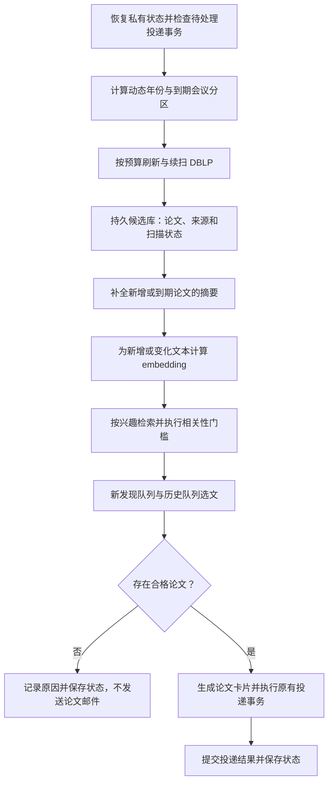

# CCF Paper Scout 推荐质量与会议更新优化方案

> 文档日期：2026-10-20。状态：待审查的实施设计，本文不代表功能已经实现。
>
> 分析基线：远程 `main` 提交 `99498fb7ddc7d0214a92f8db9dea73f9a76d0c7e`。本地当前分支为 `fix/dblp-resilient-fallback`；本次只新增方案文档，不调整运行代码、不改变线上投递。

> 后续实施：`update-paper` 已按此设计进行代码落地；上面的状态描述保留为方案形成时的记录。实际已实现能力、默认开关与仍需个人标注的部分，以 [实施与部署说明](update-paper-implementation.md) 为准。

## 1. 目标与实施边界

解决两个用户可感知的问题：随着投递天数增加，推荐论文逐渐偏离研究方向；新一届会议论文上线后，没有持续进入推荐。

目标行为：

1. 每次最多推荐 10 篇，质量合格时才投递；允许少于 10 篇，零合格论文时不发送论文邮件。
2. 已经扫描但不相关的论文，不阻碍系统继续发现后续页面的论文。
3. 新会议年份自动进入检查范围；已有年份的延迟收录、分批上线和摘要更新也能被重新检查。
4. 通过标题、摘要和研究方向判断相关性，不把通用关键词重合作为充分依据。
5. 在普通 GitHub-hosted Linux CPU runner 上完成日常任务，不训练模型，不依赖 GPU。
6. 保留现有 CCF-A 资格校验、Zotero 排重、私有状态存储和投递事务保护。

第一版不建设独立推荐平台，不引入向量数据库、用户 Web 界面或自建服务器；不一次性扩展所有会议的数据源。优先复用 Python、SQLite、GitHub Actions 和现有可选 LLM 服务。

## 2. 已确认的现状与证据

以下结论来自基线代码检查。论文数量来自 2026-10-20 对官方 DBLP SPARQL 的一次查询，是当时的索引快照，不代表官方录用总数。

| 项目 | 当前行为 | 直接影响 |
| --- | --- | --- |
| 查询年份 | `config.example.json` 写死 `[2026, 2025]` | 目前会查 AAAI 2026，但跨年不会自动加入 2027 |
| 分页起点 | 每次 `start = page_index * page_size`，从 0 开始 | 反复扫描相同前页 |
| 提前停止 | 累积至少 30 篇未投递论文就停止 | 不相关的未投递论文也能阻止继续采集 |
| 采集上限 | 每页 100 条，每个会议年份最多 5 页 | 即使扫描满额，也只覆盖最多 500 条原始记录 |
| 游标 | SQLite 定义了 `source_cursors` 和读写方法，但采集流程没有使用 | 没有跨日推进扫描的能力 |
| 选文补位 | 主方向、探索方向不足后，用 `other` 补位 | 前期相关论文推完后，邮件逐渐偏题 |
| 最低分 | `min_score = 0.01` | 不能有效阻止弱相关论文 |
| 排序分数 | 词频与兴趣词权重累加，仅对兴趣画像归一化 | 分数不等于标准余弦相似度，长摘要可能占优势 |
| 年份优先级 | 仅在基础分相同时辅助排序 | 没有明确的新发现论文优先机制 |
| 摘要补全 | 先按标题排序，再优先补全靠前论文 | 标题不明显但摘要相关的论文容易被漏评 |
| LLM | 在选文之后生成翻译和论文卡片 | 当前不负责相关性筛选 |
| 候选持久化 | `papers` 主要由选文记录写入，没有完整候选正文库 | 无法在完整历史候选上统一重排 |

本次 DBLP 查询结果：AAAI 2025 为 3,508 条，AAAI 2026 为 4,920 条；查询约束为 `Inproceedings`、`streams/conf/aaai` 和 `yearOfPublication`。因此，不能把当前问题归因为“DBLP 还没有 AAAI 2026”。

### 2.1 候选停滞的典型过程

假设第一页有 100 篇论文，其中 10 篇相关、90 篇不相关。相关论文发送后，90 篇不相关论文仍属于“未投递”。它们继续满足 30 篇的停止条件，下一天仍可能只取第一页。更深页里的相关论文无法进入候选。

如果只提高推荐门槛，这 90 篇可能永远不发送，采集停滞会更明显。因此，质量门槛和发现流程必须一起修复。

### 2.2 尚不能直接断言的事项

未读取私有状态仓库中的历史推荐和个人兴趣全文，不能给出最近一个月实际相关率、各主题占比或 AAAI 2026 未入选的逐篇原因。实施时应补充离线诊断，区分未采集、缺摘要、被排重、低相关和已投递。

## 3. 目标工作流



发现和推荐在逻辑上分离，第一版仍放在一个每日 workflow 内串行执行。这样避免两个任务并发修改私有状态仓库。后续确有必要时，再拆成独立发现任务和投递任务。

核心约束：发现进度不依赖是否发送论文；只有成功投递才更新已投递状态；新发现、已评估、不相关、已收藏均不能被混写为“已投递”。

## 4. 优先修复：质量门槛与每日数量

### 4.1 数量语义

`max_results` 明确表示上限。移除默认 `other` 补位：主方向合格论文优先，探索方向默认最多 1 篇；不足上限时直接少发。探索论文单独标注，不能伪装成主方向论文。

零合格论文应记为 `no_qualified_papers`；来源整体失败应记为 `source_unavailable`。两者不能都表现为“成功但没有推荐”。零论文运行的发现状态仍须保存。

### 4.2 主方向边界

默认主方向沿用 RL、MARL、LLM-assisted RL，但补充清晰描述和正反例：

| 方向 | 重点判断 | 容易混淆的情况 |
| --- | --- | --- |
| RL | 是否实际研究策略、价值、奖励、探索、决策或相关学习方法 | 仅背景中提到 RL，或使用泛化的 learning 表述 |
| MARL | 是否涉及多主体交互下的强化学习问题 | 多个 LLM agent 协作，但没有强化学习问题 |
| LLM-assisted RL | LLM 是否帮助奖励设计、规划、探索、策略学习等 RL 环节 | 使用 RL 微调 LLM，不一定符合该方向 |
| LLM Agent 探索 | 是否研究与用户方向有实际联系的代理方法 | 仅出现 agent 一词 |

RLHF、推理模型强化学习、具身控制等交叉领域的边界，需要通过用户标注样本明确，不能由程序一律视为相关或一律排除。

规则识别可补充规范化缩写和同义表达，但必须处理 `RL`、`agent` 等歧义。规则在第一阶段用于保守筛选，后续作为语义排序的辅助信号。

### 4.3 分数迁移

先修正词项排序中候选长度的影响；保留词项匹配作为可解释的基线。新的词项分数、embedding 余弦值和 LLM 判定必须分开保存，不继续共用含义模糊的 `score`。

不沿用 `min_score=0.01`，也不预设“余弦大于 0.8 才相关”。不同模型、输入和语料的分布不同，阈值必须校准。没有通过校准的语义模式只能预览，不能直接替代生产门槛。

## 5. 发现流程：动态年份、完整扫描与持续刷新

### 5.1 年份策略

新增两种互斥模式：

- `fixed`：继续支持显式 `years`，便于复现和指定历史会议。
- `rolling`：按 `Asia/Shanghai` 的运行日期生成当前年和上一年；下一年低频探测，发现记录后进入活跃同步。

例如 2026-10-20 的正常活跃范围为 2026、2025；2027 处于低频探测范围。进入 2027 年后自动切换主要范围，不能继续只查 2026、2025。

不假设所有会议每年召开，也不以“会议已结束”推断索引完整。对旧年份使用较低频率复查，保留延迟收录窗口；窗口外的论文保存在候选库中，是否参与历史推荐由配置决定。

同步修改 `src/ccf_paper_scout/cli.py::load_config()` 和配置生成脚本。目前 CLI 强制要求非空 `years`，只改 JSON 会导致 doctor 与运行入口行为不一致。

### 5.2 扫描停止条件

停止采集的依据改为“到达末尾或本次预算用尽”，不再依据未投递论文数量。预算耗尽属于 `partial`，不能标成完整扫描。

每个 `source + venue_key + year` 持久化扫描位置。每页论文与下一页游标在同一个事务中保存：先入库，再推进。请求失败时保留原位置，避免跳页。

初次接入 AAAI 2026 时，按 100 条一页估算，4,920 条记录至少约需 50 页；不能把扫描 5 页当成初始化完成。实际页数受结果去重、来源变化和分页协议影响。

### 5.3 OFFSET 的限制与补漏

游标并不能单独解决更新：上游新增或修改记录会改变页边界；Search API 与 SPARQL 的排序也可能不同。

第一版采用以下可落地策略：

1. 每个扫描周期从头按稳定顺序遍历，分多次运行续扫到末尾。
2. 续扫时重叠读取上一页，通过稳定 DBLP ID 去重。
3. 活跃分区每天额外检查少量头部页面，但只把它当快速探测，不声称能够捕获所有新增。
4. 一个周期完成后，按分区活跃程度安排下一轮从头复查；周期过长时告警。
5. 一轮扫描固定 transport 和查询签名。若 Search API 切换 SPARQL，不沿用旧 OFFSET，保留已入库数据并重启该分区周期。

不能只因为本次总数没变就跳过扫描：新增、删除、标题修正可能相互抵消。对服务端最大 OFFSET、单次 LIMIT 和查询超时应先验证；到达服务端上限属于受限扫描，不能标记完成。必要时改用经过验证的 SPARQL keyset 分页，但不在第一阶段同时重写两套协议。

上游并非事务快照，“完成”表示本轮按当前协议遍历到末尾，不代表永久无遗漏。周期性重新遍历是第一版的补漏机制。

### 5.4 调度和预算

保留现有全局限速、反机器人检测、有限重试和 SPARQL 降级。不要为加快初始化并发轰炸 DBLP。

建议以全局每日 80 页、单分区最多 12 页作为初始请求预算，优先当前年未完成分区，再按到期时间轮转其他分区。该数值是试运行起点，需根据服务响应、覆盖周期和 Actions 耗时调整。

以完整周期最长 7 天为初步目标。对每个分区计算剩余页数和剩余天数，分配最低扫描份额；如果所有分区所需页数超过总预算，明确报告容量不足，而不是承诺 7 天发现。预算、限速和上游分页稳定性共同决定发现时延。

未来年份查询成功但为空可记为 `not_indexed_yet`，减少复查频率；网络失败必须记为错误，不能记为空。低频探测分区不能稀释活跃分区的成功率判断。

## 6. 持久候选库与状态设计

采用现有 SQLite，不新增服务。为了避免破坏旧表与旧版本中的位置式 `INSERT ... VALUES`，第一版新增独立候选表，保留原 `papers`、推荐记录和投递表。

| 表或现有能力 | 建议保存的数据 | 作用 |
| --- | --- | --- |
| 新增 `candidate_papers` | DBLP ID、标题、作者、会议、年份、DOI、链接、摘要、摘要来源、首次发现与最近更新、正文哈希 | 保存所有已发现论文，不仅保存入选论文 |
| 扩展 `source_cursors` | transport、查询签名、周期 ID、续扫位置、开始与完成时间、状态、最近错误、最近观测总数 | 可恢复的分区扫描 |
| 新增 `metadata_fetch_state` | 论文 ID、提供方、尝试次数、下次尝试时间、结果类别 | 避免反复查询缺摘要论文 |
| 新增 `paper_embeddings` | 论文 ID、正文哈希、模型签名、维数、向量 BLOB、生成时间 | 增量向量缓存 |
| 新增 `profile_cache` | 画像哈希、模型签名、方向与参考论文向量 | 避免每天重算 Zotero 兴趣 |
| 新增 `relevance_cache` | 论文正文哈希、画像哈希、评估器版本、结构化判断 | 缓存重排或 LLM 判断 |
| 现有推荐与投递表 | 入选次序、各项分数、投递结果 | 保留审计和成功投递排重 |

`source_cursors` 的 schema 迁移必须同步调整现有位置式插入，改成显式列名插入。其他表也采用显式列名，避免后续加字段时失效。

状态分开维护：

- 论文已发现，不等于已经读过或发送过。
- 主方向不相关的判断绑定画像和评估器版本；方向变化后可以重新评估。
- 用户明确排除的论文保留独立记录，不能因模型升级自动重新推荐。
- 历史 delivered IDs 继续生效。没有完整元数据的旧记录不应被当作新发现论文。
- 首次发现时间、来源发表年份、来源最近更新是不同概念，不能相互替代。

初期向量作为 SQLite BLOB 保存，减少额外文件和状态白名单改动；不将模型权重存入私有状态仓库。候选正文会增加数据库体积，必须纳入第 9 节的容量监控。

## 7. 摘要补全与数据质量

先补全元数据，再对可靠文本进行语义判断。继续使用 OpenAlex 作为首个提供方，优先使用规范化 DOI，来源能提供可信摘要时直接复用。

修正当前“仅从 `ee` 提取 DOI”的限制：首先检查规范化 `doi` 字段，再从链接解析。没有 DOI 时，第一版允许保留标题级候选；需要按标题匹配外部记录时，必须同时核对年份、作者或会议，不能拿第一个搜索结果直接补入。

预算改为“每次最多尝试多少次请求”，而不只是“获得多少个成功摘要”。否则大量缺摘要记录会消耗不可控请求。将成功、未找到、限流和服务错误分别保存。

建议初始元数据请求预算为每日 200 次：主要用于新发现且可能相关的候选，同时留出约 20% 给轮转补全，降低标题初筛带来的偏差。首次初始化按天回填，不要求一天补齐全部摘要。

临时失败指数退避；未收录或缺摘要可在 7～30 天后重查，新会议初期使用较短间隔。具体配额、认证和标识要求按提供方当时政策配置，不在代码里假定永久免费额度。

持久化摘要来源、获取时间和正文哈希。标题或摘要变化后，只重算对应论文的 embedding 与相关性判断。缺摘要不是不相关，必须记录为信息不足；默认不凭 LLM 补写不存在的摘要。

## 8. CPU embedding 与相关性筛选

### 8.1 模型与依赖

首选候选模型为 `BAAI/bge-small-en-v1.5`：英文、384 维、约 3,300 万参数，适合当前主要为英文标题和摘要的场景。备选为 `intfloat/e5-small-v2`；先对同一标注集比较，再固定一个生产模型。

模型用于推理，不进行训练。生产固定模型 commit revision、依赖版本和编码器签名；实际 revision 在下载与基准测试时确定，不能把模型名当作不可变版本。输入前缀、池化、归一化、截断和分块规则均属于签名的一部分。

新增可选安装项 `.[semantic]`，基础 CLI 和不启用语义模式的用户继续保持轻依赖。Actions 的语义任务固定 Python 3.12，优先安装 CPU 版 PyTorch，再安装兼容的 `sentence-transformers` 与项目可选依赖；维护经过实际安装验证的约束文件。

轻量模型权重是百 MB 量级，但框架和安装文件占用显著更大，不能以模型权重大小估算全部下载量或磁盘需求。第一版不同时引入 ONNX 和量化后端，只有基准结果证明必要时再优化。

### 8.2 输入与长文本

使用真实的英文标题与摘要。编码前清理空白和格式，不把 LLM 生成的推荐理由加入输入。

对超过模型 token 上限的摘要，先按 tokenizer 分块，标题加入各块上下文，块向量平均后重新 L2 归一化；空摘要单独标记为 `title_only`。每篇最多 3 块作为初始上限，并记录截断情况。标题级论文与完整摘要论文分开评估阈值。

batch 初始取 16，设备显式为 `cpu`。每次进程加载一次模型，批量处理新增或文本变化的论文。遇到实际内存不足可以减小 batch 后有限重试；不能无限重启整个任务。

### 8.3 兴趣表示

不要把整个 Zotero 库拼成一段文本，也不要把多个差异较大的方向强行平均为一个向量。

第一版为每个主要方向保存一段明确描述，并使用少量人工确认的正样本文献形成方向参考集合；Zotero 中用户选定 collection 的其他论文作为较弱辅助信号。没有方向标签的参考论文，不自动分配为强正样本。

分别计算候选与方向描述、方向参考论文的归一化余弦相似度。保存各方向分数和最接近的参考文献，作为可审查依据。组合权重在校准集上确定，显式方向的权重高于未分类的全库兴趣。

用户近期新增 Zotero 文献可影响辅助画像，但未反馈的系统推荐不自动成为强正样本，避免推荐结果自我强化。用户明确不相关的反馈优先作为排除或重排约束。

### 8.4 召回、门槛与重排

建议流程：

1. 从完整候选库排除已投递、Zotero 已有和明确排除的论文。
2. 使用词项匹配和 embedding，分别为每个方向召回候选，合并去重后形成最多约 100 篇的待评估集合。
3. 按已校准的相关性规则筛选，主方向和探索方向使用不同资格要求。
4. 可选对前 30 篇调用现有 LLM 做相关性判断，最终选出最多 10 篇。

第一版默认不新增第二个本地 cross-encoder 模型，以控制依赖、CPU 时间和维护范围。LLM 判断属于独立可选功能，不能与“翻译启用”绑定。

结构化判断至少包含 `relevant / irrelevant / uncertain`、方向、所研究问题、摘要中的证据和简短理由。要求模型依据真实文本判断，不输出凭空编造的实验或性能。论文文本按外部数据处理，不能执行其中的指令。

LLM 的自报置信度不是校准概率。语义分数也不是百分比。邮件展示“匹配方向与依据”，不显示误导性的“相似度 95%”。

同一论文在正文、画像、模型和规则均未变化时复用缓存。模型服务失败时只使用已经校准过的确定性筛选；若配置要求 LLM 复核才能通过，则保留 `uncertain` 并跳过，不能自动放宽为旧版补位策略。

### 8.5 新论文与历史论文

先通过质量门槛，再分队列。默认最多 7 篇来自最近 14 天首次发现的合格论文，其余名额用于历史高质量论文；一侧不足时可由另一侧合格论文补足，探索论文仍受总量最多 1 篇约束。

首次初始化或重建索引时，整批旧论文不能因“今天入库”都被包装成新论文。bootstrap 期间标记历史导入；正式持续刷新后再启用新发现队列。邮件中分别展示会议年份和首次发现日期。

年份和新鲜度只影响合格论文之间的排序，不能让新但不相关的论文压过合格门槛。历史队列不设置必须清空的目标。

## 9. GitHub Actions 部署与资源预算

### 9.1 工作流组织

保留现有 `Paper Scout Daily` 与 `Paper Scout Manual`，以及共同的生产 concurrency group。自动任务仍只在默认分支执行。

每日任务建议顺序：恢复状态 → 检查未解决投递事务 → 验证配置与模型 → 发现和补全 → 向量更新 → 选文 → 生成报告 → 原有投递事务 → checkpoint 与持久化。

现有待处理事务检查位于实际业务运行前；新流程应继续保证遇到未解决邮件事务时不再次投递。不要改动现有 pending、审批门和 SMTP accepted 标记的恢复语义。

手动任务增加 `discover` 和 `evaluate` 两个模式：前者只更新发现与元数据状态，后者在隔离状态副本上评估；现有 preview 同样不发送邮件、不推进 delivered。需要保存发现进度时必须明确为 discover 模式，不能让 preview 偷偷修改生产数据库。

### 9.2 缓存与隐私

| 内容 | 初期存放位置 | 要求 |
| --- | --- | --- |
| 公共模型权重 | runner 的 Hugging Face 缓存，通过 Actions cache 复用 | 缓存键包含系统、Python、模型 revision 和依赖约束哈希 |
| 个人兴趣、候选正文、向量和相关性记录 | 私有状态仓库中的 SQLite | 不上传公共 cache 或公开 artifact |
| 运行摘要 | GitHub step summary | 只输出数量、耗时、版本和错误类别，不输出完整个人语料 |
| 详细评估和预览 | 私有存储或本地文件 | 公共仓库 artifact 不能当作私密空间 |

仅缓存模型目录，不缓存整个用户目录或私有状态路径。公开仓库的 PR 任务不接入生产 Secrets，也不读取个人状态。

`actions/cache` 的同名 key 不会被原地更新；公共权重适合固定键，持续变化的个人向量库不能依赖它作为唯一持久存储。现有私有状态 clone/push 继续作为初期持久化路径。

若新增独立向量文件，需要同步更新 `scripts/actions_state.py` 的 ALLOWED；本方案第一版使用 SQLite BLOB，因此可以避免新增大文件白名单。但数据库 schema 和容量仍须检查。

### 9.3 内存、时长与成本

384 维 float32 向量原始大小约为 `论文数 × 384 × 4` 字节：5,000 篇约 7.7 MB，50,000 篇约 76.8 MB，不含正文、索引、画像和数据库开销。采用归一化矩阵相乘即可完成个人规模检索，初期无须 FAISS 或独立向量数据库。

普通 CPU runner 通常足以运行小模型，但不同仓库套餐、runner 类型和版本的资源不同，部署时记录实际 CPU、内存和剩余磁盘。模型推理速度不能仅凭参数量承诺，必须实测。

建议基准：冷启动一次；暖缓存分别编码 100、500、1,000 篇真实论文，记录加载时间、编码时间、最大内存、文本块数和下载流量。

初步运行预算如下，属于验收目标而非已测结果：

- 日常有效新增或更新 embedding 每次最多 500 篇；超出部分留待后续运行。
- 暖缓存语义编码阶段目标控制在 10 分钟内，峰值内存目标低于 4 GiB。
- 不含原有定时投递等待的日常有效处理时间目标低于 30 分钟。
- 保留 daily 的长超时，以兼容现有等到 09:00 才投递的行为；手动 preview 单独设置合理超时。

如果超出预算，依次减少本次新增文本数、减少分块或 batch、延后历史回填，再评估 ONNX。不得通过降低相关性门槛或删除 delivered 历史换取速度。

私有状态仓库保存 SQLite 会累积二进制历史；小规模可先接受，但不是无限扩展方案。建议数据库达到 100 MiB 或 clone/push 耗时持续超过 60 秒时评估迁移到私有对象存储。这是运维触发线，不是 GitHub 文件限制说明。实施前设定状态保留策略；不自动重写 Git 历史。

## 10. 建议配置接口

以下是拟新增或调整的配置片段，尚不被当前程序支持；需与实现一起落地。未展示的现有 SMTP、LLM 翻译与路径配置继续保留。

```json
{
  "year_policy": {
    "mode": "rolling",
    "timezone": "Asia/Shanghai",
    "lookback_years": 1,
    "probe_next_year": true
  },
  "dblp": {
    "page_size": 100,
    "max_pages_per_partition_per_run": 12,
    "max_pages_per_run": 80,
    "overlap_pages": 1,
    "full_cycle_target_days": 7,
    "request_delay_seconds": 3.0,
    "max_attempts": 3,
    "sparql_fallback": true,
    "minimum_success_ratio": 0.75
  },
  "metadata": {
    "max_requests_per_run": 200,
    "exploration_fraction": 0.2
  },
  "semantic": {
    "enabled": true,
    "model": "BAAI/bge-small-en-v1.5",
    "revision": "REPLACE_WITH_VALIDATED_MODEL_COMMIT",
    "device": "cpu",
    "batch_size": 16,
    "max_chunks_per_paper": 3,
    "max_updated_papers_per_run": 500
  },
  "selection": {
    "policy_version": "research-profile-v1",
    "calibration_id": "REPLACE_WITH_APPROVED_CALIBRATION",
    "require_calibration": true,
    "allow_other_fill": false,
    "max_exploration_results": 1,
    "new_discovery_days": 14,
    "new_discovery_slots": 7
  },
  "relevance_review": {
    "enabled": false,
    "max_candidates_per_run": 30
  },
  "max_results": 10
}
```

说明：

- `lookback_years=1` 表示当前年加上一年；fixed 模式使用旧 `years`，不与 rolling 同时解释。
- 移除以未投递数量作为采集停止条件的旧参数；旧配置出现这些参数时明确提示迁移，不能静默沿用。
- 生产必须替换两个占位符并验证。校准数据包含画像版本、模型签名、各类阈值和评估结果；没有有效配置时语义模式只允许 evaluate/preview。
- `max_results` 在 daily workflow 和生成脚本中也要保持“上限”的语义；现有 `assert == 10` 只是在检查配置，不应被解释为每天必须输出 10 篇。
- 保留 `minimum_success_ratio` 约束活跃分区检查成功率，但另行报告扫描完整度。请求成功不代表该会议全部论文已经覆盖。

## 11. 文件级实施清单

| 文件 | 计划改动 |
| --- | --- |
| `paper_scout.py` | 取消 other 补位，修正基础分数，调用发现库，连接新筛选流程，区分无合格与来源失败 |
| `state_store.py` | 增量 schema 迁移、候选与扫描状态、向量和评估缓存；保留投递历史 |
| `src/ccf_paper_scout/discovery.py`（新增） | 年份解析、分区预算、周期续扫和幂等入库 |
| `src/ccf_paper_scout/semantic.py`（新增） | 可选模型加载、文本分块、批量编码、向量签名和相似度 |
| `src/ccf_paper_scout/cli.py` | rolling/fixed 校验，增加 discover/evaluate 入口及 doctor 诊断 |
| `scripts/build_actions_config.py` | 传递新增配置、校验模式、继续只从环境读取凭据 |
| `scripts/actions_state.py` | 核对迁移后数据库 checkpoint、完整性与备份流程 |
| `scripts/evaluate_recommendations.py`（新增） | 使用固定私有评测集比较排序与门槛，不发送邮件 |
| `pyproject.toml` | 增加 semantic 可选依赖和必要的模块打包配置 |
| 依赖约束文件（新增） | 固定 Python 3.12 CPU 语义环境，记录模型版本 |
| `.github/workflows/paper-scout-daily.yml` | 模型缓存、CPU 依赖、阶段统计；保留原有投递保护 |
| `.github/workflows/paper-scout-manual.yml` | discover/evaluate 模式、隔离预览、避免公开上传个人画像 |
| `.github/workflows/ci.yml` | 基础版本矩阵与独立语义 smoke test |
| `config.example.json`、`README.md` | 新配置语义、实际算法说明、升级与运维流程 |

只提取有明确职责的新模块，不顺带重写 SMTP、翻译器或整个 CLI。新模块必须包含在构建产物中，安装后从非仓库目录导入验证，避免测试只覆盖工作目录源码。

## 12. 分阶段交付与上线顺序

### 阶段 A：阻止质量退化并修复扫描停滞

范围：取消其他方向补位；允许少发；改成预算控制的持久续扫；动态年份与 CLI 同步；新增基础候选表；保留词项排序。

完成标准：第一页有 90 篇不相关未投递论文时仍能推进到第二页；AAAI 2026 可分批完成初次遍历；跨年自动加入新年；没有合格论文时保存发现状态而不发邮件。

这是最先上线的可独立收益版本，不能因为 embedding 尚未完成而延后。

### 阶段 B：摘要持久化与运行可观测性

范围：DOI 规范化、请求预算、失败负缓存、正文哈希、分区状态与未入选原因诊断。

完成标准：重复运行不重复查询未到重试期的缺摘要记录；可以解释某篇 AAAI 2026 论文当前未入选的原因；来源失败与暂未收录能区分。

### 阶段 C：语义模型离线评估与影子运行

范围：CPU embedding、增量缓存、方向画像、私有评测集、模型资源基准、配置校准。

完成标准：依赖在 Actions CPU 环境安装成功；模型缓存冷/暖启动通过；同一候选快照上的推荐质量达到第 13 节目标。影子模式只比较，不改变生产选文和 delivered。

### 阶段 D：语义推荐灰度与可选 LLM 复核

范围：启用已经校准的语义门槛、新发现/历史队列；需要时加入少量 LLM 判断；连续观察 7～14 天。

完成标准：没有重复投递，没有质量补位，发现周期符合预算；人工反馈稳定达标。LLM 复核只有离线实验显示收益且成本可接受时才启用，不作为阶段 A 的依赖。

## 13. 评估方法与验收标准

### 13.1 人工评测集

准备至少 60 篇用户标注论文作为起点，覆盖三个主方向、探索方向和困难负例。约 20 篇用于校准，40 篇留作独立测试；样本较少时报告波动，不把结果当成长期保证。

至少包含“词面相似但研究问题不同”和“词面不同但研究问题相关”的样本，以及缺摘要、新旧年份论文。相同论文的预印本与会议版应归到同一集合，避免校准/测试泄漏。测试集不能被加入强正样本画像。

使用同一份固定候选快照比较：原版算法、修复后的词项基线、embedding、embedding 加可选复核。新数据导致的覆盖提升与排序本身的提升分开统计。

指标至少包含：

- 实际推荐论文中的人工相关比例，初步目标不低于 80%；每次实际不足 10 篇时以实际数量为分母。
- 返回的合格论文数、零结果比例和探索论文数，防止靠“全部不推荐”取得表面高精度。
- 在已完整标注的测试候选范围内计算相关论文召回率；未标注论文不能直接当负例。
- 主方向误判、新发现论文入选、标题级论文表现和错误类型。

只有 40 篇独立测试论文时，不能用 `Recall@50` 等缺乏区分力的指标宣称改进。需要检索指标时先扩大并完整标注相应候选池，再比较 Recall@K、NDCG 等指标。

### 13.2 必须通过的自动化场景

| 场景 | 预期结果 |
| --- | --- |
| 第一页未投递但全不相关，第二页有相关论文 | 续扫后第二页论文入库，不受 30 篇条件阻止 |
| 一次运行用完扫描预算 | 保存游标并报告 partial，下一次继续 |
| 某页请求失败或事务中断 | 不跨过该页，不产生重复候选 |
| 上游在前页或中间插入新记录 | 重叠与下一轮复查能够补入；记录实际发现时延 |
| 中途切换 Search API/SPARQL | 重启该分区扫描周期，不混用 OFFSET |
| 2026-12-31 与 2027-01-01 | 按配置时区正确生成滚动年份 |
| 未来年份为空与来源超时 | 分别记录 not_indexed_yet 与 error |
| 当天只有 3 篇合格论文 | 只选 3 篇，不使用 other 补位 |
| 当天零合格论文 | 不发论文邮件，发现状态仍保存 |
| 相同论文跨日重复出现 | 候选更新，成功投递历史不重复发送 |
| 相同文本和模型重复运行 | 不重新编码，缓存命中可验证 |
| 摘要、画像或模型版本变化 | 只失效受影响的向量/评估缓存 |
| 需要复核但 LLM 失败 | 不自动放宽门槛，不编造依据 |
| preview/evaluate | 不发送邮件，不修改生产 delivered 或扫描状态 |
| 恢复旧私有数据库 | 历史 delivered 全部保留，schema 幂等迁移 |
| 邮件失败、pending 恢复和 push 失败 | 保持现有投递保护，不因新发现库绕过 |

单元测试使用固定假响应和小向量，不依赖实时 DBLP 或下载模型。实际模型与网络检查采用独立集成任务：PR 基础 CI 不携带私人 Secrets；语义 smoke test 在固定 Python 3.12 CPU 环境中执行。

## 14. 可观测性与故障处理

每次运行记录 code SHA、配置哈希、画像版本、模型 revision、校准版本和阶段耗时。建议结构化摘要如下：

```text
discovery: active_partitions=... completed=... partial=... failed=...
discovery: new_papers=... updated_papers=... overdue_cycles=...
metadata: requests=... abstracts_added=... missing=... deferred=...
semantic: cache_hits=... encoded=... deferred=... peak_memory_mb=...
selection: primary=... exploration=... below_threshold=... uncertain=...
delivery: selected=... delivered=... reason=...
```

提供按论文 ID 查询诊断的能力：是否在来源、是否已入库、是否被收藏/投递排除、摘要是否完整、各方向分数、门槛版本以及最终原因。标题和私人画像只出现在私有诊断中。

故障策略：

- DBLP 整体不可用：保留缓存，默认停止正常投递并报告来源故障；后续如允许缓存投递，必须显式配置最大数据年龄并标注降级，不能静默使用陈旧数据。
- 新分区暂时为空：继续处理其他活跃分区，按低频计划再查。
- 模型无法下载：有一致版本本地缓存则继续；没有缓存时停止语义生产选文，或使用已单独校准的词项模式，不能临时切换未知门槛。
- 历史回填积压：保留队列并告警，不阻止已完成候选的推荐。
- 私有状态 push 失败：明确工作流失败，沿用投递事务恢复；不得把已被 SMTP 接受的邮件当成未发送自动重发。

## 15. 数据迁移、上线与回滚

上线从最新 main 新建实施分支，分阶段提交。本文所在的旧修复分支仅用于保存方案；实施前重新确认主分支和线上配置。

迁移顺序：

1. 在没有生产写入的窗口，对私有状态创建可恢复备份，记录 SHA 和数据库完整性检查结果。
2. 在隔离副本执行幂等 schema 迁移，只新增或兼容扩展表，不删除历史投递记录。
3. 保留 `seen.json` 与 SQLite delivered 的并集，导入旧论文时不能重新计入待发送。
4. 运行 discover 完成优先会议初始化，再运行 preview/evaluate；不要一次性把所有历史候选视为“新上线”。
5. 阶段 A、B 通过后先上线；阶段 C 完成校准后再灰度启用 semantic。
6. 观察状态保存、邮件事务和评估指标，确认后合并默认分支并重新触发 workflow；Re-run 旧任务不会自动使用新提交。

回滚策略：

- 算法回滚通过配置切回已经验证的词项策略，同时保留不补位和新的发现库；不回到已知会停滞的采集策略。
- 应用版本回滚前验证数据库兼容。迁移后保留旧表并不能自动证明旧程序安全，需专门做兼容测试。
- 不直接恢复投递前的旧数据库：这会丢失升级期间成功发送记录并造成重复邮件。必要时先合并新增 delivered IDs，再恢复兼容状态。
- 回滚不删除已有 embedding；模型签名不匹配时忽略对应缓存，后续按需重建。

## 16. 主要风险与取舍

| 风险 | 应对与边界 |
| --- | --- |
| embedding 仍把泛化 AI 论文判断为相关 | 人工校准、方向描述、困难负例和可选复核 |
| 元数据长期缺摘要 | 保留信息不足状态和后续回填，不假装精确理解论文 |
| 全量覆盖增加来源负载 | 有界请求、全局限速、轮转续扫和到期检查 |
| 论文库变化导致 OFFSET 漏项 | transport 固定、页重叠、周期从头复查与覆盖告警 |
| 私有数据库和 Git 历史持续增大 | 记录容量与 clone/push 耗时，达到触发线后迁移存储 |
| 新模型安装过慢或 CPU 超预算 | 固定 CPU 依赖与模型缓存，增量计算，最后才考虑后端优化 |
| 兴趣画像逐渐偏移 | 显式方向优先、参考样本受控、用户反馈和版本审计 |
| 用户看到的日报数量减少 | 清楚说明每日数量是上限，以相关性优先；监控是否因采集不足造成少发 |

本方案最先解决的是“看不到新候选”和“用不相关论文补位”。embedding 用来改善语义匹配，无法替代完整发现、可靠摘要、质量门槛和真实反馈。

## 17. 审查时需要确认的产品选择

以下不阻碍阶段 A、B 的实现，但应在语义生产上线前通过样本明确：

1. RLHF、LLM 推理强化学习、具身控制与纯 LLM Agent 各自属于主方向、探索方向还是排除方向。
2. 默认“最多 10 篇、探索最多 1 篇、零合格不发送论文邮件”是否符合阅读习惯。
3. 是否接受缺摘要论文默认延期，或允许单独标注的少量标题级候选。
4. LLM 相关性复核是否启用，以及可接受的每日调用量；默认先关闭，通过离线评估再决定。

建议交付物包括：阶段化代码变更、兼容迁移与回滚说明、CPU 实测报告、私有标注集评估结果，以及 7～14 天灰度观察记录。本文作为这些交付物的实施与验收依据。
